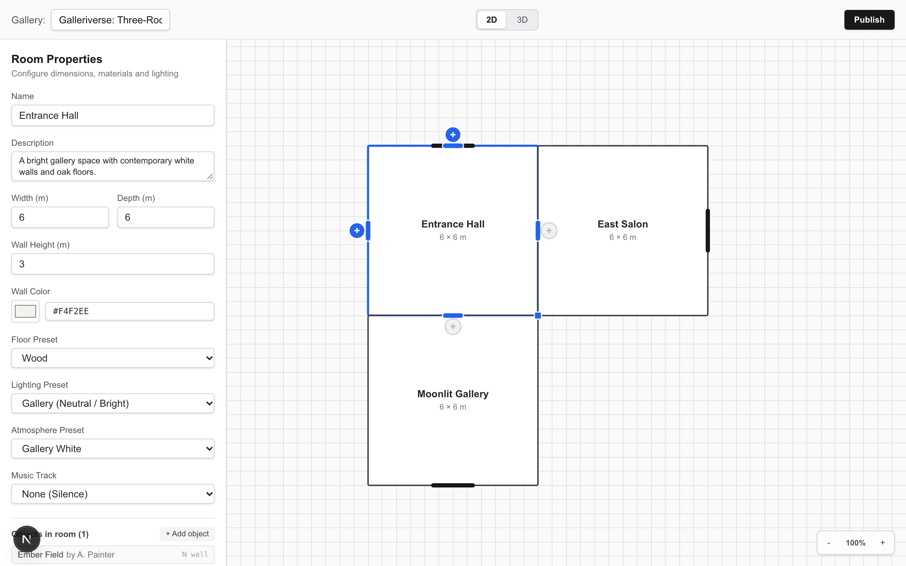
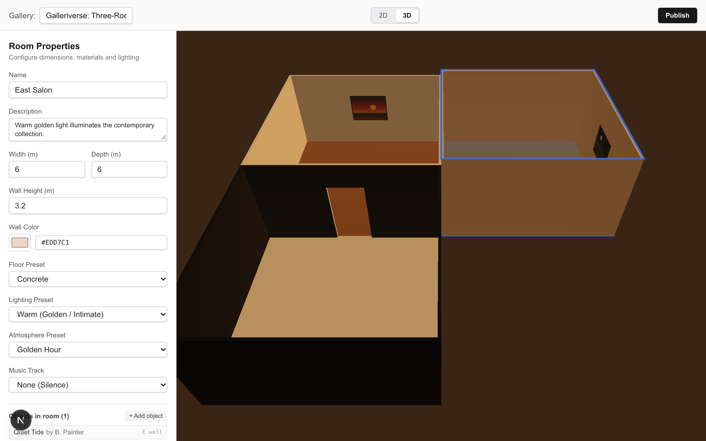
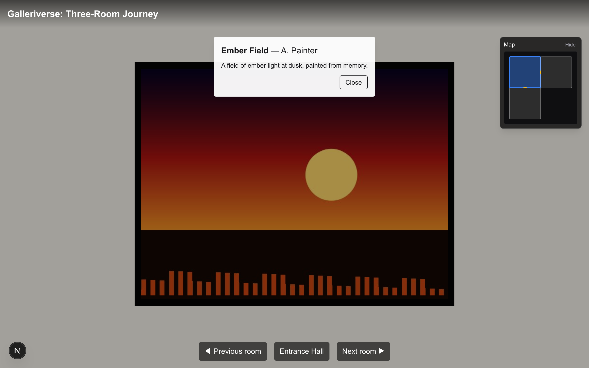
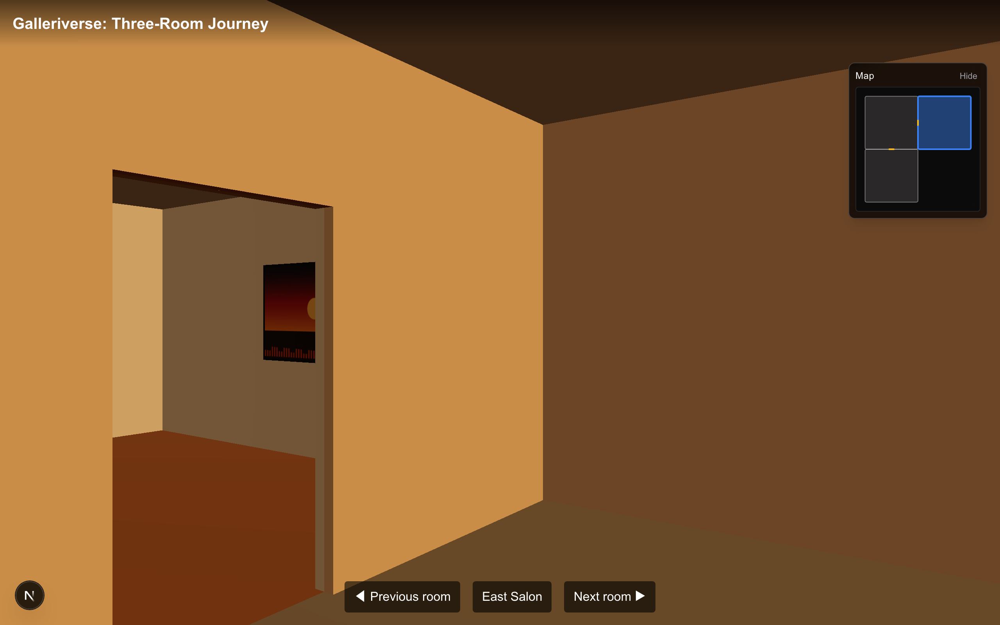
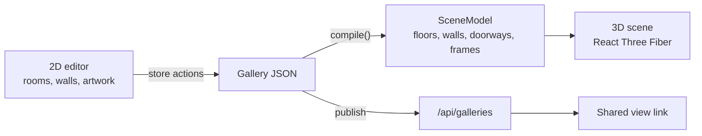

# Galleriverse

Galleriverse lets creators with no coding or 3D experience build an immersive gallery for their art. They draw rooms on a simple 2D floor plan, set each room's colours and lighting, and hang artwork with titles and stories on the walls. Galleriverse compiles that layout into a 3D gallery that anyone can walk through from a shared link, with no account needed. The editor is the product; the 3D gallery is what it produces. Built for Hacklanta 2026 (Adobe Creative track).

**Live:** [https://galleriverse.vercel.app/](https://galleriverse.vercel.app/)


## Visual Tour

|                       2D Floor Plan Editor                        |                      3D Editor Preview                      |
| :---------------------------------------------------------------: | :---------------------------------------------------------: |
|               |            |
|                 **3D Viewer with Artwork Plaque**                 |                  **Atmosphere & Lighting**                  |
|  |  |

## Demo

- **Live app:** [https://galleriverse.vercel.app/](https://galleriverse.vercel.app/)
- **One-command pre-demo check:** run `npm run predemo` to verify the live production site against the full end-to-end flow (publish, tour in a new context, plaque interaction, secret edit key) and print a clear PASS/FAIL verdict before presenting. Works cross-platform on Windows (cmd, PowerShell, Git Bash), macOS, and Linux.
- **Demo checklist:** see the living [Demo checklist](https://github.com/PegasusXLab/main/blob/Docs/plan/sprints/sprint-2.md#demo-checklist-living-read-before-every-demo-run) (`plan/sprints/sprint-2.md` on the Docs branch):
  1. Open [https://galleriverse.vercel.app/](https://galleriverse.vercel.app/) and confirm the latest deployment is live.
  2. Run `npm run predemo` to verify live site health.
  3. Start on the home screen (`/`) and click "New blank gallery" (or select a template).
  4. Build connected rooms on the 2D floor plan using directional "+ Add room" buttons.
  5. Select rooms to customize wall colours, floor finishes, and atmospheric lighting presets.
  6. Select a wall to upload artwork, adding a title, artist, and story.
  7. Switch to the 3D tab to orbit and inspect the gallery space in real time.
  8. Click "Publish" to generate a visitor view link (`/g/:id`) and a secret creator edit link (`/edit/:id?key=...`).
  9. Open the view link in a new browser window: tour through doorways, look around, view artwork, and click frames to open plaques.

## Run it locally

Requires Node.js 24. No accounts or API keys are needed: without storage credentials, galleries and images are saved to `.data/` on your disk.

```bash
npm ci
npm run dev        # http://localhost:3000, editor at /edit/local
```

| Script              | What it does                                      |
| ------------------- | ------------------------------------------------- |
| `npm test`          | Unit tests (Vitest)                               |
| `npm run test:e2e`  | Browser tests (Playwright), see `tests/e2e/`      |
| `npm run predemo`   | Pre-demo check against live site (`E2E_BASE_URL`) |
| `npm run lint`      | ESLint                                            |
| `npm run typecheck` | Generates Next route types, then `tsc --noEmit`   |
| `npm run format`    | Prettier                                          |
| `npm run build`     | Production build                                  |

The first time you run the browser tests, install Chromium with `npx playwright install chromium`.

## How it works

The creator only ever edits one gallery document in 2D. A pure function, `compile()`, turns it into a `SceneModel`: plain data describing floors, wall segments, doorways and picture frames. The 3D renderer reads only that model.



- **Rooms are rectangles on a 1 m grid.** The 2D x and y axes map to 3D x and z.
- **Doorways are computed, not drawn.** Where two rooms share an edge, `compile()` cuts an opening 1.2 m wide and 2.2 m high, centred on the overlap. It then splits each wall into solid pieces around the opening.
- **No double walls.** Each room builds its walls inset by half the wall thickness, so shared walls sit back to back without flickering.
- **`compile()` has no three.js inside.** It is plain TypeScript, so it is unit-tested directly. The renderer can change, for example to first-person controls, without touching it.
- **No accounts.** Publishing returns a view link and a secret edit link. The server stores only a hash of the edit key.

## Tech stack

- Next.js (App Router) and TypeScript, styled with Tailwind CSS
- three.js with React Three Fiber and drei for the 3D view
- zustand for editor state, @use-gesture/react for 2D interactions, zod for validation
- Vitest and Playwright for tests
- Hosting on Vercel. Gallery JSON and images are stored in Vultr Object Storage through an S3 client.

## Team

Quang, Vic, Parth and Sergio.

## Inspiration disclosure

Inspired by basement.studio's website ([basementstudio/website-2k25](https://github.com/basementstudio/website-2k25)). No code, shaders, models, textures or fonts were copied.
