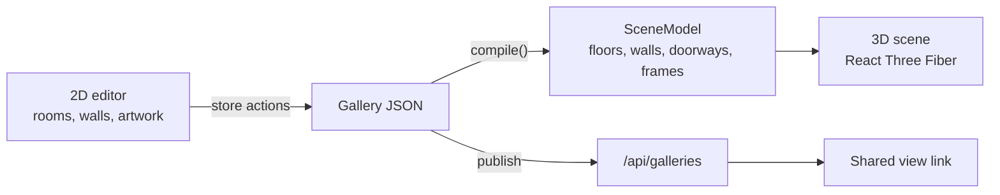

# Pegasus

Pegasus lets creators with no coding or 3D experience build an immersive gallery for their art. They draw rooms on a simple 2D floor plan, set each room's colours and lighting, and hang artwork with titles and stories on the walls. Pegasus compiles that layout into a 3D gallery that anyone can walk through from a shared link, with no account needed. The editor is the product; the 3D gallery is what it produces. Built for Hacklanta 2026 (Adobe Creative track).

**Live:** https://galliverse.vercel.app/

## Run it locally

Requires Node.js 24. No accounts or API keys are needed: without storage credentials, galleries and images are saved to `.data/` on your disk.

```bash
npm ci
npm run dev        # http://localhost:3000, editor at /edit/local
```

| Script              | What it does                                    |
| ------------------- | ----------------------------------------------- |
| `npm test`          | Unit tests (Vitest)                             |
| `npm run test:e2e`  | Browser tests (Playwright), see `tests/e2e/`    |
| `npm run lint`      | ESLint                                          |
| `npm run typecheck` | Generates Next route types, then `tsc --noEmit` |
| `npm run format`    | Prettier                                        |
| `npm run build`     | Production build                                |

The first time you run the browser tests, install Chromium with `npx playwright install chromium`.

## How it works

The creator only ever edits one gallery document in 2D. A pure function, `compile()`, turns it into a `SceneModel`: plain data describing floors, wall segments, doorways and picture frames. The 3D renderer reads only that model.



- **Rooms are rectangles on a 1 m grid.** The 2D x and y axes map to 3D x and z.
- **Doorways are computed, not drawn.** Where two rooms share an edge, `compile()` cuts an opening 1.2 m wide and 2.2 m high, centred on the overlap. It then splits each wall into solid pieces around the opening.
- **No double walls.** Each room builds its walls inset by half the wall thickness, so shared walls sit back to back without flickering.
- **`compile()` has no three.js inside.** It is plain TypeScript, so it is unit-tested directly. The renderer can change, for example to first-person controls, without touching it.
- **No accounts.** Publishing returns a view link and a secret edit link. The server stores only a hash of the edit key.

## Tech stack

- Next.js (App Router) and TypeScript, styled with Tailwind CSS
- three.js with React Three Fiber and drei for the 3D view
- zustand for editor state, @use-gesture/react for 2D interactions, zod for validation
- Vitest and Playwright for tests
- Hosting on Vercel. Gallery JSON and images are stored in Vultr Object Storage through an S3 client.

## Team

Quang, Vic, Parth and Sergio.

## Inspiration disclosure

Inspired by basement.studio's website ([basementstudio/website-2k25](https://github.com/basementstudio/website-2k25)). No code, shaders, models, textures or fonts were copied.
