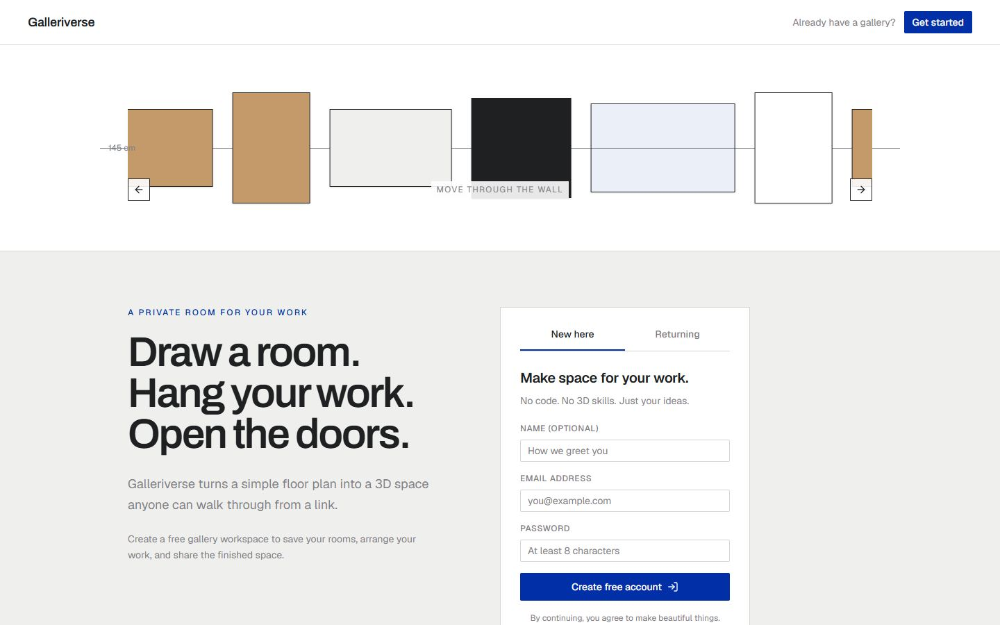
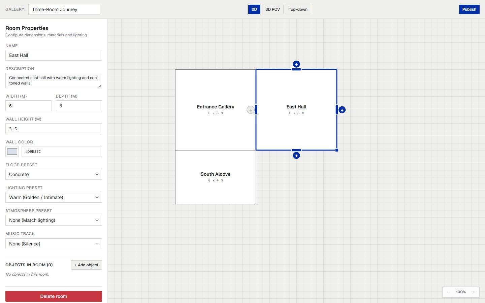
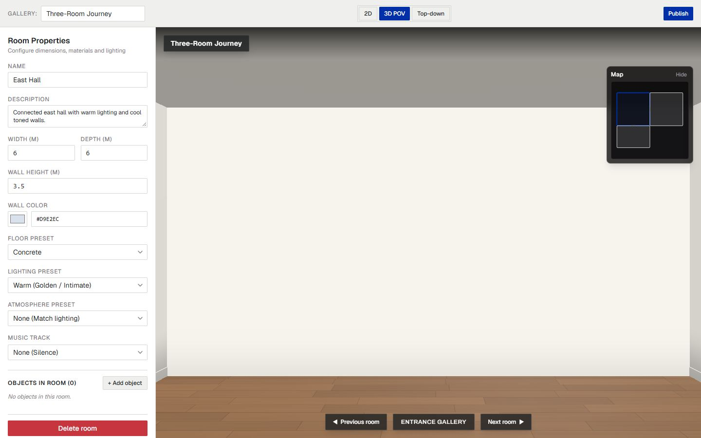
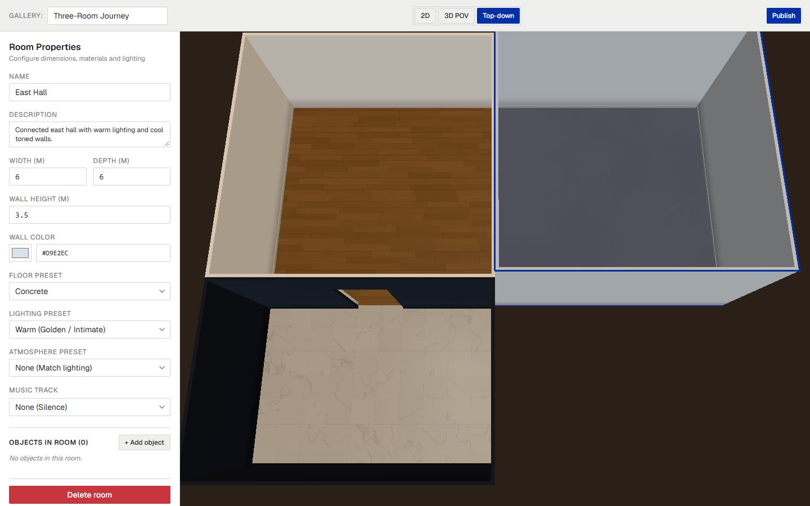
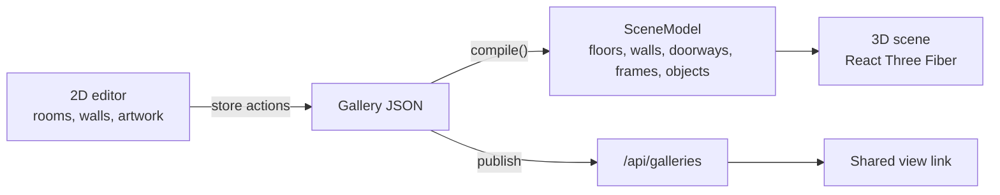

# Galleriverse

Galleriverse lets creators with no coding or 3D experience build an immersive gallery for their art. They draw rooms on a simple 2D floor plan, set each room's colours, lighting and sound, and hang artwork with titles and stories on the walls. Galleriverse compiles that layout into a 3D gallery that anyone can walk through from a shared link, on a laptop or a phone, with no account needed. The editor is the product; the 3D gallery is what it produces. Built for Hacklanta 2026 (Adobe Creative track).

**Live:** [https://galleriverse.vercel.app/](https://galleriverse.vercel.app/)


## Try it

1. Open [galleriverse.vercel.app](https://galleriverse.vercel.app/). Optionally create a free account, so your galleries are listed under **Your galleries** next time.
2. Pick **New blank gallery** or a template (**Hall**, **Journey**).
3. Draw and connect rooms on the 2D plan with the **+** buttons, then set walls, floors, lighting, atmosphere and music for each room.
4. Hang artwork on a wall: upload an image and add a title, artist and story.
5. Switch to **3D POV** to walk through the unsaved gallery exactly as a visitor will, or **Top-down** for an overview.
6. **Publish** to get a view link to share and a secret edit link to come back to.

## Visual Tour

|                           Landing page                            |                     2D floor plan editor                      |
| :---------------------------------------------------------------: | :-----------------------------------------------------------: |
|                         |         |
|                 **3D POV: preview as a visitor**                  |                     **Top-down overview**                     |
|                    |         |
|                 **3D viewer with artwork plaque**                 |                  **Atmosphere and lighting**                  |
|  |  |

## Features

- **2D floor plan editor:** rectangular rooms on a 1 m grid; add neighbours with directional **+** buttons, drag, resize, snap, and undo/redo (Ctrl+Z / Ctrl+Shift+Z).
- **Three editor views:** **2D**, **3D POV** (the real visitor tour, rendered from the live unsaved gallery), and **Top-down** (orbit overview).
- **Rooms with character:** wall colour, floor finish, lighting presets, and atmosphere presets (Gallery White, Golden Hour, Neon Bunker, Moonlit, Custom) that blend as you move between rooms.
- **A gallery-grade look:** image-based lighting, picture lights over each artwork, ceilings, baseboards, soft corner shading, textured wood/concrete/marble floors, and framed, matted artwork.
- **Artwork with stories:** upload images (resized in the browser), add title, artist and story; visitors click a frame to read its plaque.
- **Room sound:** built-in music tracks, or upload your own (MP3, WAV, OGG or M4A, up to 4 MB). Audio is checked by its file signature and plays as visitors enter the room.
- **Visitor tour:** click to travel, drag to look around 360°, Previous/Next room, a room-arrival title, and a minimap. On phones the viewer is view-only, with a tap-to-open map.
- **Optional accounts:** register or log in with email and password to see **Your galleries** on the start page. Publishing and edit links work without an account.
- **Free-standing objects (rendering):** galleries can hold objects on plinths, from a built-in library of 12 CC0 models (see Credits), cutout sculptures, or `.glb` models. The editor's add-object flow is coming next.
- **One design system:** a single Klein-blue accent (`#002fa7`), Archivo and Geist type, and shared UI primitives across the landing page, editor and viewer.

## Demo

- **Live app:** [https://galleriverse.vercel.app/](https://galleriverse.vercel.app/)
- **One-command pre-demo check:** run `npm run predemo` to verify the live production site against the full end-to-end flow (publish, tour in a new context, plaque interaction, secret edit key) and print a clear PASS/FAIL verdict before presenting. Works on Windows (cmd, PowerShell, Git Bash), macOS and Linux.

## Run it locally

Requires Node.js 24. No accounts or API keys are needed: without storage credentials, galleries and images are saved to `.data/` on your disk, and accounts use a development-only session secret.

```bash
npm ci
npm run dev        # http://localhost:3000, editor at /edit/local
```

Optional environment variables (see `.env.example`; real values go in your local `.env` or in Vercel, never in the repo):

| Variable                                                                             | Purpose                                           |
| ------------------------------------------------------------------------------------ | ------------------------------------------------- |
| `VULTR_S3_ENDPOINT`, `VULTR_S3_BUCKET`, `VULTR_S3_ACCESS_KEY`, `VULTR_S3_SECRET_KEY` | Vultr Object Storage; unset = local `.data/`      |
| `AUTH_SECRET`                                                                        | Signs the login session cookie (32+ random bytes) |

| Script              | What it does                                      |
| ------------------- | ------------------------------------------------- |
| `npm test`          | Unit tests (Vitest)                               |
| `npm run test:e2e`  | Browser tests (Playwright), see `tests/e2e/`      |
| `npm run predemo`   | Pre-demo check against live site (`E2E_BASE_URL`) |
| `npm run lint`      | ESLint                                            |
| `npm run typecheck` | Generates Next route types, then `tsc --noEmit`   |
| `npm run format`    | Prettier                                          |
| `npm run build`     | Production build                                  |

The first time you run the browser tests, install Chromium with `npx playwright install chromium`.

## How it works

The creator only ever edits one gallery document in 2D. A pure function, `compile()`, turns it into a `SceneModel`: plain data describing floors, wall segments, doorways, picture frames and objects. The 3D renderer reads only that model.



- **Rooms are rectangles on a 1 m grid.** The 2D x and y axes map to 3D x and z.
- **Doorways are computed, not drawn.** Where two rooms share an edge, `compile()` cuts an opening 1.2 m wide and 2.2 m high, centred on the overlap, then splits each wall into solid pieces around it.
- **No double walls.** Each room builds its walls inset by half the wall thickness, so shared walls sit back to back without flickering.
- **`compile()` has no three.js inside.** It is plain TypeScript, so it is unit-tested directly, and the same tour component powers both the editor's 3D POV and the shared viewer.
- **Edit links stay secret.** Publishing returns a view link and a secret edit link; the server stores only a hash of the edit key. Accounts (optional) use salted scrypt password hashes and a signed, HTTP-only session cookie.
- **Storage:** gallery JSON, images and audio go to Vultr Object Storage through an S3 client and are served same-origin through `/api/files`; private records (accounts) are never served.

## Tech stack

- Next.js (App Router) and TypeScript, styled with Tailwind CSS
- three.js with React Three Fiber and drei for the 3D view
- zustand for editor state, @use-gesture/react for 2D interactions, zod for validation, howler for audio
- Vitest and Playwright for tests, including a cross-browser and phone matrix
- Hosting on Vercel; storage in Vultr Object Storage

## Team

Quang, Vic, Parth and Sergio.

## Inspiration disclosure

Inspired by basement.studio's website ([basementstudio/website-2k25](https://github.com/basementstudio/website-2k25)). No code, shaders, models, textures or fonts were copied.

## Credits

The built-in object library (`public/library/`) uses CC0 models from [Poly Haven](https://polyhaven.com). Textures were resized and the files packed into single `.glb` files.

| Object               | Author          | Source                                                                                         |
| -------------------- | --------------- | ---------------------------------------------------------------------------------------------- |
| Classic armchair     | Kirill Sannikov | [polyhaven.com/a/ArmChair_01](https://polyhaven.com/a/ArmChair_01)                             |
| Leather ottoman      | Caspian Fortune | [polyhaven.com/a/Ottoman_01](https://polyhaven.com/a/Ottoman_01)                               |
| Painted bench        | Kirill Sannikov | [polyhaven.com/a/painted_wooden_bench](https://polyhaven.com/a/painted_wooden_bench)           |
| Wooden stool         | Kirill Sannikov | [polyhaven.com/a/chinese_stool](https://polyhaven.com/a/chinese_stool)                         |
| Round coffee table   | Ulan Cabanilla  | [polyhaven.com/a/coffee_table_round_01](https://polyhaven.com/a/coffee_table_round_01)         |
| Potted succulent     | James Ray Cock  | [polyhaven.com/a/potted_plant_04](https://polyhaven.com/a/potted_plant_04)                     |
| Ceramic vase         | James Ray Cock  | [polyhaven.com/a/ceramic_vase_01](https://polyhaven.com/a/ceramic_vase_01)                     |
| Brass vase           | Rico Cilliers   | [polyhaven.com/a/brass_vase_03](https://polyhaven.com/a/brass_vase_03)                         |
| Marble bust          | Rico Cilliers   | [polyhaven.com/a/marble_bust_01](https://polyhaven.com/a/marble_bust_01)                       |
| Horse statue         | Rico Cilliers   | [polyhaven.com/a/horse_statue_01](https://polyhaven.com/a/horse_statue_01)                     |
| Standing photo frame | James Ray Cock  | [polyhaven.com/a/standing_picture_frame_01](https://polyhaven.com/a/standing_picture_frame_01) |
| Vintage oil lamp     | Monsta3D        | [polyhaven.com/a/vintage_oil_lamp](https://polyhaven.com/a/vintage_oil_lamp)                   |
