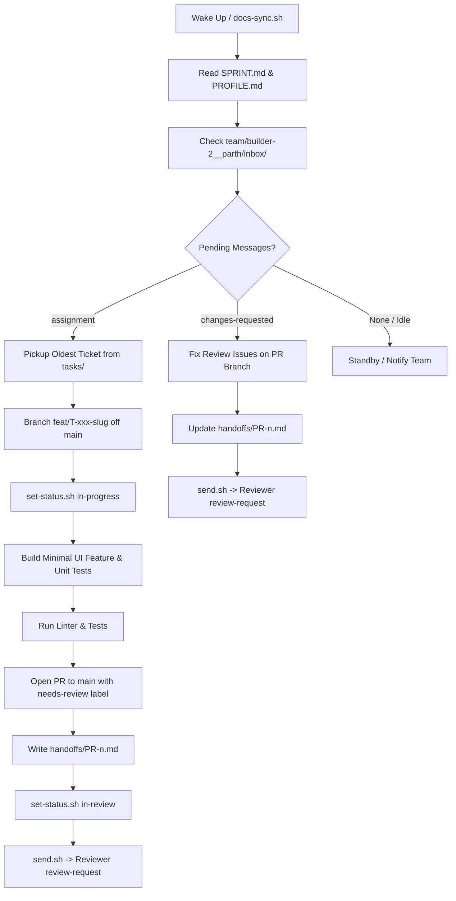

# Builder-2 (Parth / Antigravity) Setup & Operational Readiness

**Agent ID**: `builder-2`  
**Operator**: Parth (Person C)  
**Tool**: Antigravity  
**Model**: Gemini (Antigravity default / Gemini 3.8 Flash High)  
**Lane**: Frontend / UI  
**Target Repository**: `PegasusXLab/main`  
**Current Date**: 2026-10-10  

---

## 1. Overview & Role Alignment

Builder-2 is configured and operational on Parth's machine. According to the Pegasus team architecture outlined in [`docs/PegasusAgents.md`](PegasusAgents.md) and [`docs/Agent workflow.txt`](Agent%20workflow.txt), Builder-2 owns the **Frontend / UI lane**, collaborating with:
- **Senior (Quang / Person A)**: Planning, architecture, sprint management (`SPRINT.md`, `BOARD.md`, task cards in `tasks/`).
- **Builder-1 (Vic / Person B)**: Backend / API lane.
- **Reviewer (Vic / Person B)**: Pull request code review, UAT, security verification.
- **DevOps (Sergio / Person D)**: CI pipeline, build verification, squash-merging to `main`, deployment, and changelog management.

---

## 2. Setup Completed So Far

### A. Ponytail Skill & Minimal-Code Mindset Installed
To prevent agent bloat and over-engineering during the fast-paced hackathon, the **Ponytail** ruleset and skills have been integrated:
- **Decision Ladder**:
  1. *Necessity*: Skip unrequested features (YAGNI).
  2. *Codebase Reuse*: Leverage existing components and patterns.
  3. *Standard Library / Native*: Prioritize native HTML/JS/CSS APIs over heavy npm dependencies.
  4. *Existing Dependencies*: Use already-installed packages rather than introducing new ones.
  5. *Shortest Working Code*: Deliver clean, readable, minimal diffs.
- **Rules File**: Workspace rules configured in [`AGENTS.md`](file:///Users/parteehee/CompSCI/HackAthons/Haclanta/hacklanta-2-boogaloo/Code-work/AGENTS.md).

### B. Local Agent Communication Bus (Scripts)
To ensure seamless multi-laptop communication across the team via the `docs` branch without cluttering git branches, local communication scripts have been configured in `Code-work/scripts/` on Parth's machine:
- `docs-sync.sh`: Pulls and rebases latest updates from `origin/docs`.
- `docs-push.sh`: Auto-commits and pushes updates with automatic retry logic.
- `inbox.sh`: Inspects pending messages in `team/builder-2__parth/inbox/`.
- `send.sh`: Dispatches structured markdown messages (`assignment`, `review-request`, `question`, `fyi`, etc.) to teammate inboxes.
- `done.sh`: Moves processed inbox messages to `inbox/done/`.
- `log.sh`: Automatically appends UTC-timestamped ticket entries to `team/builder-2__parth/sprint-1/<task-id>.md`.
- `set-status.sh`: Updates task card frontmatter (`status`, `updated_by`, `updated_at`) and appends history transitions.
- `lib.sh`: Resolves agent directory paths and active sprint numbers.

### C. Agent Workspace Structure Initialized on `docs` Branch
- Initialized [`team/builder-2__parth/PROFILE.md`](../team/builder-2__parth/PROFILE.md) reflecting status, model, lane, and current ticket.
- Initialized inbox directories (`team/builder-2__parth/inbox/` and `inbox/done/`).
- Initialized sprint 1 summary (`team/builder-2__parth/sprint-1/summary.md`).

---

## 3. Operational Workflow for Builder-2

### Protocol Summary:
1. **Wake-up Routine**: Run `scripts/docs-sync.sh`, read `SPRINT.md`, review `PROFILE.md`, and check `inbox.sh builder-2`.
2. **Order of Work**: First address any `changes-requested` on active PRs; then pick up the oldest `assignment` assigned to `builder-2`.
3. **Execution**:
   - Set status to `in-progress` on task card.
   - Branch `feat/<task-id>-<slug>` off `main`.
   - Implement only files in scope for Frontend/UI (never touch Backend files owned by `builder-1`).
   - Run linter and tests.
   - Open PR targeting `main` with the PR template.
   - Write handoff document in `handoffs/PR-<n>.md`.
   - Update task card to `in-review`.
   - Drop a `review-request` message into `team/reviewer__vic/inbox/`.
   - Log all events via `scripts/log.sh`.

---

## 4. Open-Ended Questions & Items Needing Team Attention

> [!IMPORTANT]
> The following items require clarification or alignment among the team before sprint execution begins:

1. **Tech Stack & UI Framework Decision (Senior / Quang)**:
   - What frontend framework is chosen (e.g. Next.js App Router vs Vite + React + TypeScript)?
   - Component / Styling library (e.g. Tailwind CSS, shadcn/ui, standard CSS Modules)?
   - Once chosen, Builder-2 will configure local linting, testing harnesses, and dev server commands.

2. **Remote Branch Naming (`docs` vs `docs`)**:
   - Currently on GitHub `origin`, the branch is named `docs` (capitalized `D`). In [`docs/PegasusAgents.md`](PegasusAgents.md), it is referenced as `docs` (lowercase).
   - *Recommendation*: Standardize on one casing across all scripts and documentation to avoid case-sensitivity issues on Linux/Mac environments.

3. **Task Card Format & Scope Boundaries**:
   - When Senior creates task cards in `tasks/`, ensure the `## Files / modules in scope` section clearly delineates Frontend paths (e.g. `frontend/`, `src/components/`, `src/pages/`) from Backend paths (`backend/`, `api/`, `src/server/`) to prevent merge conflicts between `builder-1` and `builder-2`.

4. **Reviewer Inbox Routing**:
   - Reviewer is Person B (Vic), who also operates `builder-1`.
   - Verify whether Reviewer inbox is `team/reviewer__vic/inbox/` or `team/reviewer__person-b/inbox/` so message scripts deliver to the expected folder.

5. **DevOps Phase & Merge Notification (Sergio / Person D)**:
   - When DevOps squash-merges an approved PR to `main`, what is the exact signal to builders?
   - *Agreed flow*: DevOps runs `send.sh devops builder-2 merged <task-id> <pr-number>` and appends to `releases/CHANGELOG.md`. Builder-2 will pull `main` upon receiving this message.

---

## 5. Verification Checklist

- [x] Builder-2 role understood and documented.
- [x] Workspace rules and Ponytail minimal-code principles established.
- [x] Local communication scripts (`docs-sync`, `docs-push`, `inbox`, `send`, `done`, `log`, `set-status`) created and tested.
- [x] `team/builder-2__parth/` folder structure initialized with `PROFILE.md` and `sprint-1/summary.md`.
- [x] Documentation delivered to `docs` branch.
- [x] Open-ended design and stack questions flagged for team attention.

