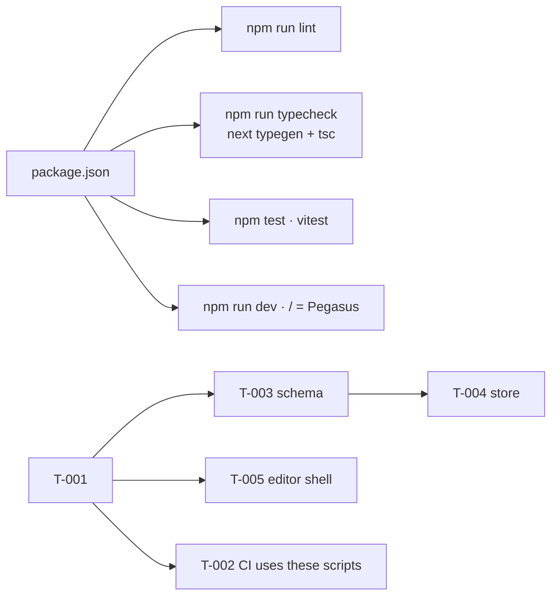

# Handoff: PR-1 / T-001
## Builder notes
### What changed
An empty, runnable Next.js 16.4 app (App Router, strict TS, Tailwind 4). All plan/stack.md packages are pinned to exact versions, except howler and @aws-sdk/client-s3, which the card leaves for later.
- **Scripts:** `lint`, `typecheck` (`next typegen && tsc --noEmit`), `test` (`vitest run`), `format`, `format:check`, `dev`, `build`.
- **Structure:** `@/*` alias; `.gitkeep` module folders; one smoke test in `src/lib/smoke.test.ts`; README; `.gitignore`.
- **Placeholder:** `/` shows "Pegasus".

Things worth knowing:
- **`agentRules: false` in `next.config.ts`.** Next 16.3+ writes an `AGENTS.md` to the repo root on `next dev` when it detects an AI agent. Our AGENTS.md lives on Docs, so this is off. Its message ("read `node_modules/next/dist/docs/`, not memory") is sent to the senior for the Gotchas list (R13).
- **Tailwind 4 goes through the Turbopack CSS loader** (`@tailwindcss/turbopack`) configured in `next.config.ts`. There's no `postcss.config` or `tailwind.config`; that's the 16.4 template's setup.
- **`typecheck` runs `next typegen` first.** That generates global route types like `LayoutProps`, so CI can typecheck without a full build.
- **Version pins stay in the template's majors:** TypeScript 5.9.3, not 7.x; ESLint 9.39.5, not 10.x. `@types/node` is 24.x to match Node 24 and vitest 5's peer range.
- **`npm audit`: 5 high, all one braces ReDoS advisory.** It comes only through eslint-config-next's lint deps. It's dev-only and has no non-breaking fix, so it's left as is.
- **Template defaults `cacheComponents: true` and `partialPrefetching: true` are kept.** Note for later cards: Cache Components changes how dynamic data in server components behaves. Read `node_modules/next/dist/docs/` before writing the API and pages.

### Diagram

### How to test
```bash
git fetch origin && git switch feat/T-001-scaffold   # or check out PR #1
npm ci
npm run lint && npm run typecheck && npm test && npm run format:check && npm run build
npm run dev   # open http://localhost:3000 -> "Pegasus"; no AGENTS.md appears in the repo root
```
Expected: all commands succeed; build lists `/` as static.

For T-002 (devops): CI can run `npm ci`, `npm run lint`, `npm run typecheck`, `npm test`. Node 24.

### Round 1 follow-up (builder-1)
- Added `/.data/` to `.gitignore`. Local-first update: `.data/` is the local storage fallback (ADR-008), and the card now requires it. This was the reviewer's non-blocking item 1.

## Review rounds
### Round 1 (reviewer, 2026-10-10)

**Verdict: APPROVED.** Posted as a comment because builder-1 and reviewer share Vic's GitHub account, so a formal GitHub approval isn't possible. A non-Vic approval is still needed for branch protection.

**Blocking issues**
None.

**Non-blocking suggestions**
1. `.gitignore` doesn't list `.data/`, although the card's scope mentions it. Storage moved to Vultr Object Storage (ADR-008, revised), so there's no local storage folder anymore and nothing leaks today. Add `/.data/` if a local storage fallback ever appears.
2. `npm ci` on npm 11 skips `unrs-resolver`'s postinstall (`npm warn install-scripts … approve`). Lint still passed without it, so this is harmless. devops: expect the same warning in CI.
3. FYI for the API and pages cards: `cacheComponents: true` is on in `next.config.ts:4`. Read the installed Next docs before writing dynamic server code, as the handoff says.

**What I tested** (branch `feat/T-001-scaffold` @ c2a54a0, Node 24.21.0)
- **Checks:** `npm ci`, then lint, typecheck, test, format:check and build. All exit 0. The build lists `/` as static.
- **The checks catch bad code** (temporary probe files, deleted afterwards; the tree is clean):
  - a type error fails typecheck (exit 2);
  - a failing test fails `npm test` (exit 1);
  - an untyped parameter plus an unused variable fails lint (exit 1);
  - an `@/lib/...` import resolves inside vitest.
- **UAT:** in `next dev`, `/` renders the title and `<h1>` "Pegasus", and an unknown route returns 404. No `AGENTS.md` was written to the repo root (`agentRules: false` works). The dev log shows no errors or warnings.
- **Card criteria:**
  - every dependency is pinned exactly (no `^` or `~`);
  - `howler` and `@aws-sdk/client-s3` are absent;
  - `strict: true` is on, and `@/*` maps to `./src/*`;
  - all 9 `.gitkeep` folders exist;
  - the README has the paragraph plus run steps.
- **Security:**
  - no secret-like strings in tracked files (lockfile excluded);
  - `.gitignore` covers `.env` and `.env.*` and allows only `.env.example`, plus `*.pem`, `.vercel` and `CLAUDE.local.md`;
  - all 618 lockfile packages resolve to registry.npmjs.org with integrity hashes;
  - `npm audit --omit=dev` finds 0 vulnerabilities, so the braces advisory is dev-only, as stated;
  - no CI or `.github` files, which stay in T-002's scope.
- **Not tested:** the CI run. There is no workflow yet; T-002 adds it.
## DevOps notes
CI result / merge commit / release note
