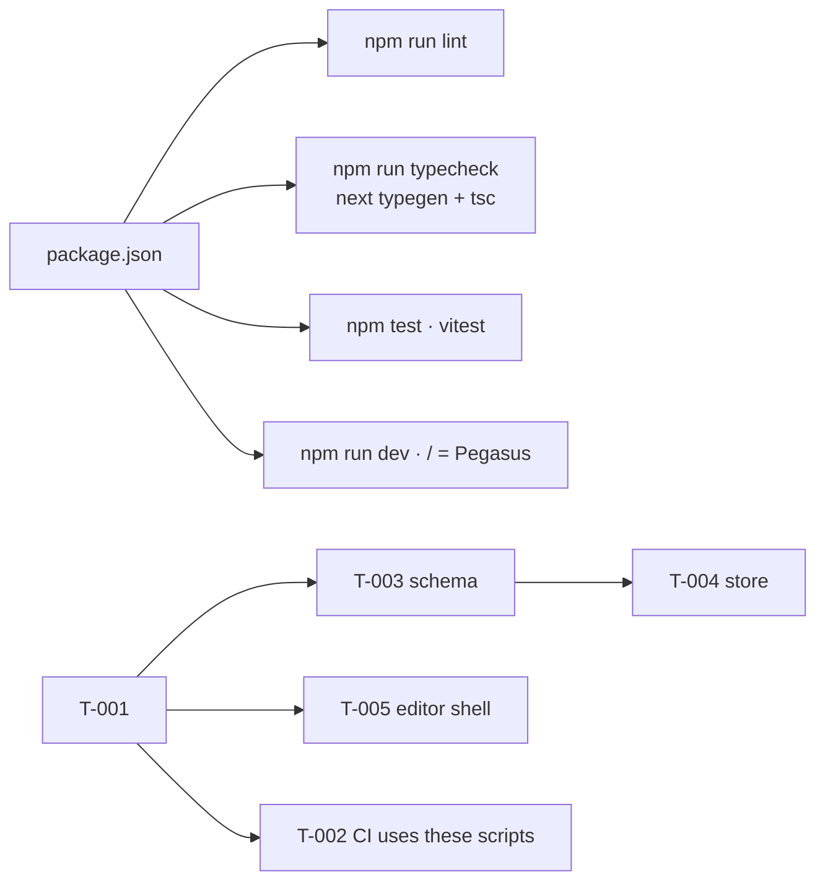

# Handoff: PR-1 / T-001
## Builder notes
### What changed
An empty, runnable Next.js 16.4 app (App Router, strict TS, Tailwind 4). All plan/stack.md packages are pinned to exact versions, except howler and @aws-sdk/client-s3, which the card leaves for later.
- **Scripts:** `lint`, `typecheck` (`next typegen && tsc --noEmit`), `test` (`vitest run`), `format`, `format:check`, `dev`, `build`.
- **Structure:** `@/*` alias; `.gitkeep` module folders; one smoke test in `src/lib/smoke.test.ts`; README; `.gitignore`.
- **Placeholder:** `/` shows "Pegasus".

Things worth knowing:
- **`agentRules: false` in `next.config.ts`.** Next 16.3+ writes an `AGENTS.md` to the repo root on `next dev` when it detects an AI agent. Our AGENTS.md lives on Docs, so this is off. Its message ("read `node_modules/next/dist/docs/`, not memory") is sent to the senior for the Gotchas list (R13).
- **Tailwind 4 goes through the Turbopack CSS loader** (`@tailwindcss/turbopack`) configured in `next.config.ts`. There's no `postcss.config` or `tailwind.config`; that's the 16.4 template's setup.
- **`typecheck` runs `next typegen` first.** That generates global route types like `LayoutProps`, so CI can typecheck without a full build.
- **Version pins stay in the template's majors:** TypeScript 5.9.3, not 7.x; ESLint 9.39.5, not 10.x. `@types/node` is 24.x to match Node 24 and vitest 5's peer range.
- **`npm audit`: 5 high, all one braces ReDoS advisory.** It comes only through eslint-config-next's lint deps. It's dev-only and has no non-breaking fix, so it's left as is.
- **Template defaults `cacheComponents: true` and `partialPrefetching: true` are kept.** Note for later cards: Cache Components changes how dynamic data in server components behaves. Read `node_modules/next/dist/docs/` before writing the API and pages.

### Diagram

### How to test
```bash
git fetch origin && git switch feat/T-001-scaffold   # or check out PR #1
npm ci
npm run lint && npm run typecheck && npm test && npm run format:check && npm run build
npm run dev   # open http://localhost:3000 -> "Pegasus"; no AGENTS.md appears in the repo root
```
Expected: all commands succeed; build lists `/` as static.

For T-002 (devops): CI can run `npm ci`, `npm run lint`, `npm run typecheck`, `npm test`. Node 24.

## Review rounds
### Round 1
**Verdict** / **Blocking issues** / **Non-blocking suggestions** / **What I tested**
## DevOps notes
CI result / merge commit / release note
