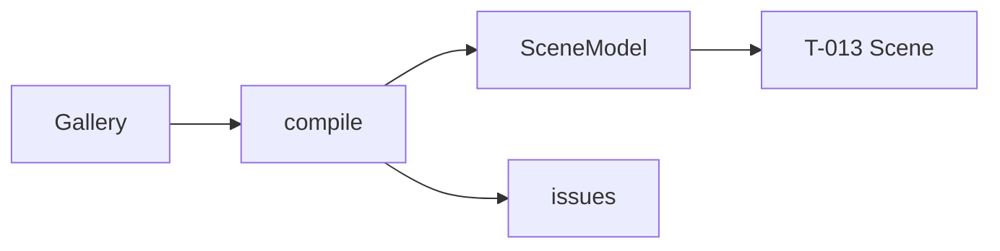

# Handoff: PR-10 / T-012 (stacked on PR #9)
## Builder notes
### What changed
- **`compile(gallery) → { scene, issues }`** plus the `SceneModel` type (`src/lib/compile/types.ts`): plan.md §5.4 with the ADR-007 additions.
- **Beyond §5.4:** `floors[].floor` (the preset), so T-013 can color floors without reading the Gallery. Question sent to the senior.
- **Doorway `center`:** on the shared line, at the middle of the opening, with y = height/2.
- **Room `view`:** eye 1.6 m, `min(1, d/4)` in from the south wall, looking at the room center.
- **No memo:** whole recompile.
- **Guard:** a test scans `src/lib/compile/` for three, React, zustand and store imports.
- **Merge order:** #9 → #10 → #11. After #9 merges I'll merge `main` into this branch, which retargets it and runs CI.

### Diagram

### How to test
```bash
git fetch origin && git switch feat/T-012-compile && npm ci
npm run lint && npm run typecheck && npm test   # 132; 11 new in compile.test.ts
```
## Review rounds
### Round 1
**Verdict** / **Blocking issues** / **Non-blocking suggestions** / **What I tested**
## DevOps notes
CI result / merge commit / release note
