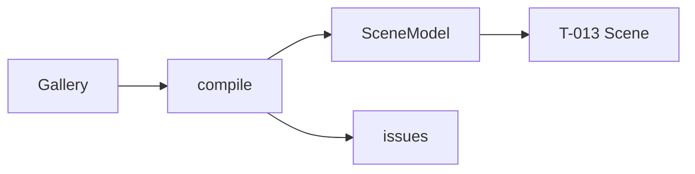

# Handoff: PR-10 / T-012 (stacked on PR #9)
## Builder notes
### What changed
- **`compile(gallery) → { scene, issues }`** plus the `SceneModel` type (`src/lib/compile/types.ts`): plan.md §5.4 with the ADR-007 additions.
- **Beyond §5.4:** `floors[].floor` (the preset), so T-013 can color floors without reading the Gallery. Question sent to the senior.
- **Doorway `center`:** on the shared line, at the middle of the opening, with y = height/2.
- **Room `view`:** eye 1.6 m, `min(1, d/4)` in from the south wall, looking at the room center.
- **No memo:** whole recompile.
- **Guard:** a test scans `src/lib/compile/` for three, React, zustand and store imports.
- **Merge order:** #9 → #10 → #11. After #9 merges I'll merge `main` into this branch, which retargets it and runs CI.

### Diagram

### How to test
```bash
git fetch origin && git switch feat/T-012-compile && npm ci
npm run lint && npm run typecheck && npm test   # 132; 11 new in compile.test.ts
```
## Review rounds
### Round 1 (reviewer, 2026-10-10): APPROVED

**Verdict: APPROVED**, provided CI is green once the PR is retargeted to `main`. ADR-010 already gates on that, so devops will check it.

**Blocking issues**
None.

**`floors[].floor`:** accepted. It's already recorded in plan/architecture.md §3 as ADR-007 amendment 1, so the senior has approved it, and it keeps T-013 reading only the SceneModel.

**Non-blocking suggestions**
1. The PR #9 suggestion (an `artwork-past-wall-top` / below-floor issue) could land here, since `compile` is where issues are collected. Optional.

**What I tested** (commit on `feat/T-012-compile`, stacked on #9, in a separate worktree)
- **Checks:** lint, typecheck, test and format:check clean locally. There's no CI run yet, because the base is `feat/T-011-walls-frames`.
- **Diff:** `review/pr-9...HEAD` contains only `compile.ts`, `types.ts` and `compile.test.ts`.
- **Card criteria:**
  - `SceneModel` matches plan.md §5.4 plus the ADR-007 additions: wall `side`/`thickness`, doorway `height`/`side`, room `view`, `floors[].floor`.
  - `frames()` receives the doorway cuts (`compile.ts:56`).
  - There's no memo; the whole gallery recompiles, which is fine for P0.
  - The F4 matrix is complete: single room, full shared wall, partial overlap, below the minimum, L-shaped fixture, art on n/e/s/w, art over a doorway.
  - The purity guard test scans `src/lib/compile/`.
- **Numbers checked by hand** (temporary probe, deleted afterwards):
  - The fixture passes `validate` and compiles to 3/20/2/2/3 (floors/walls/doorways/frames/rooms) with 0 issues.
  - Doorways:
    - Entrance|East at `[6, 1.1, 3]`, 1.2 × 2.2, side e;
    - Entrance|South at `[2, 1.1, 6]`, side s.
  - Views:
    - Entrance from `[3, 1.6, 5]` looking at `[3, 1.6, 3]`;
    - South Room from `[2, 1.6, 10]` looking at `[2, 1.6, 8.5]`;
    - a 2 × 2 room stands 0.5 m in (`[1, 1.6, 1.5]`).
  - Floors carry their preset (wood, concrete, marble).
  - The input isn't mutated, and two compiles give identical output.

## DevOps notes
CI result / merge commit / release note
