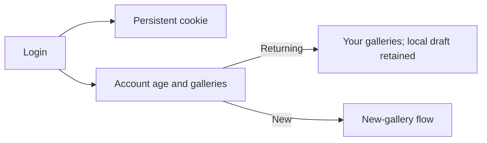

# Handoff: PR-103 / T-146
## Builder notes
### What changed
Returning users keep their workspace and go to Your galleries after login. New creators enter the new-gallery flow. Optional lastLoginAt is set at registration/login, preserving old records and identity/owner pointers; login/me/session return isNew (age under 24 h, no gallery). AuthPage and landing share authDestination.
Root cause: both auth-success handlers unconditionally called startBlankGallery. Cookie persistence and stored identity/gallery data already worked; the initial production regression failed only at the dashboard URL because it was /edit/local.
Branch fix/T-146-auth-session; head bd9a641c. Rebased onto d1abebdd. Scope expanded by senior/Quang; editor/viewer header AC dropped. No GalleryPanel/renderer edits.
### Diagram

### How to test
- npm run lint passes (existing Showcase.tsx image warning).
- npm test: 88 files, 685 tests PASS; npm run build PASS.
- E2E_BASE_URL=http://localhost:3146 npx playwright test tests/e2e/auth.spec.ts tests/e2e/auth-session.spec.ts tests/e2e/publish-view.spec.ts tests/e2e/edit-link.spec.ts --project=chromium: 11/11 PASS against production build.
- Auth-session verifies registration/reload/new tab persistence, same identity/name/gallery list after logout/login, owner editing, actual Chromium shutdown/restart, landing returning login and retained local draft.
- Unit tests cover lastLoginAt and legacy records, age/gallery classification, cookie Secure/HttpOnly/SameSite/Path/7-day TTL plus consistent logout flags.
- Login a creator with a published gallery from /login or the landing Returning tab: Your galleries, unchanged local draft. Register or log in to a recent empty account: new-gallery flow.
## Review rounds
## DevOps notes
Merge T-146 before T-147. No merge performed by builder.