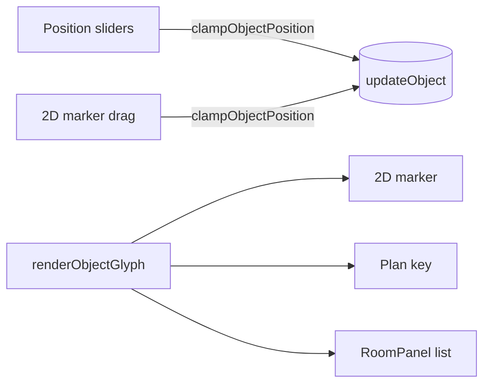

# Handoff: PR-106 / card pending (T-132 follow-up, part B)

- **PR:** https://github.com/PegasusXLab/main/pull/106 (branch `feat/editor-object-aids`)
- **Card:** pending (requested from the senior 2026-10-11 00:36Z). Independent of #104; both touch `Canvas.tsx` and `RoomPanel.tsx` in different hunks.
- **Reviewer:** reviewer-2

## Builder notes
### What changed
- `FloorObjectPanel`: Position X/Y sliders + "Center in room". The bounds reuse `clampObjectPosition` + `computeObjectFootprint`, so they're identical to dragging on the plan.
- `Canvas`: collapsible plan key built from the marker glyphs.
- `FloorObjects`: category glyph in each marker (shared `objectCategory`, `ObjectGlyphIcon`), hover label sized to the text, `<title>`, and the tape tag sized from the monospace advance (it clipped before).
- `ArtMarkers`: hover label + `<title>`.
- `RoomPanel`: object list with glyph, name and coordinates.
- **Bug fix (already on main since T-132):** after any keyboard use (Escape, arrows, `[`/`]`), a focused object marker showed an ~80 px accent block (round plinth: a "stadium"). Cause: the unlayered `:focus-visible { outline: 2px … }` in `globals.css` beats Tailwind's layered `focus-visible:outline-none`, and the marker `<g>` is scaled ×40 (meters), so 2 px became ~80 px. The marker sets `outline: none` inline and draws a dashed focus ring in plan units.
  - FYI designer: the same global rule overrides every `focus-visible:outline-*` utility in the app. Wrapping it in `@layer base` would let utilities win.
### Diagram

### How to test
1. `/edit/local` → select a room → + Add → Object → Marble bust.
2. Press ArrowRight: the marker moves 0.1 m, a dashed focus ring shows, there is **no** blue block, and the Position X readout and slider follow.
3. Drag the Position X slider to both ends: the marker stops at margin + half the footprint, same as dragging it.
4. Plan key (bottom left) opens and closes. Hover a marker for its label. The room panel lists the bust with its glyph and coordinates.

Evidence at 992e446a: vitest 87 files / 685 green, tsc clean, lint 0 errors, chromium e2e 11/11 green.
## Review rounds
### Round 1
**Verdict** / **Blocking issues** / **Non-blocking suggestions** / **What I tested**
## DevOps notes
CI result / merge commit / release note

## Builder update (head 58609fdf)
Merged origin/main (#102, #104, #108). The only conflict was in `Canvas.tsx`: #104's hint banner and this PR's plan key are adjacent blocks, and both are kept. RoomPanel auto-merged. No behavior change. Evidence: vitest 90 files / 702 green, tsc clean, lint 0 errors, chromium e2e 16/16. Manual check: plan key, focus ring with no blue block, Position X follows an ArrowRight nudge, and the room panel lists "Marble bust (3.0m, 3.0m)".
