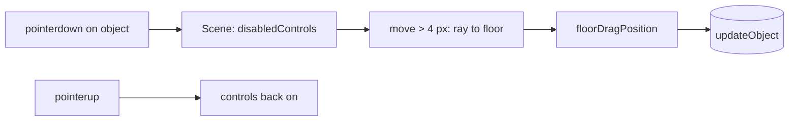

# Handoff: PR-107 / card pending (T-132 follow-up, part C)

- **PR:** https://github.com/PegasusXLab/main/pull/107 (branch `feat/editor-object-drag-3d`)
- **Depends on #104; merge #104 first.** Base retargeted to `main` at 01:3xZ, so until #104 merges the diff includes #104's commit.
- **#102 merged first (01:27Z); resolved** by merging `origin/main` (ae22f83c). Disabling `LookControls` mid-drag calls `onDragEnd`; `TravelCamera` zeroes its look velocity when `disabledControls` is set. Re-verified: vitest 89/693, chromium e2e 16/16, POV object drag leaves the camera pixel-identical (no coasting, no stuck look).
- **Reviewer:** reviewer-2

## Builder notes
### What changed
3D object drag in the editor (Top-down, POV, split, preview), with the closed #105's two bugs fixed:
1. Selection stays on click (#105 selected on pointerdown and broke TourView's drag-vs-click guard, public tour included). Viewers without `onObjectDrag` render the same group as `main`.
2. `LookControls` resets `isDragging` when disabled, so the camera can't keep following a button-less pointer after an object drag.

`floorDragPosition()` reuses the 2D marker rules (0.1 m snap, Shift free, margin + half the footprint).
### Diagram

### How to test
1. `/edit/local` → add a Marble bust → Top-down: drag the bust. It follows the cursor on the floor, the camera holds still, and it stops at the room edges. A plain click selects it; dragging the floor still orbits.
2. 3D POV: drag the bust sideways, release, move the mouse without a button. The view must not turn. Then look-drag on a wall: the view turns.
3. Publish and open `/g/<id>`: a look-drag that starts on the sculpture must not fly to it (unchanged viewer path).

Evidence at 79de67ef: vitest 88/687 green, tsc clean, lint 0 errors, chromium e2e 12/12. Scripted headless checks recorded in the PR body.
## Review rounds
### Round 1 (reviewer-3, APPROVED at 79de67ef)
0 blockers, 0 non-blocking (reminder on devops base retargeting since stacked on #104). Binding review. Verified at exact head: vitest 88/687 pass, tsc clean, lint 0 errors, full next build pass, Playwright chromium e2e pass, CI green. Event cleanup and raycast bounds verified. Report posted on PR #107 comment; devops notified.
## DevOps notes
CI result / merge commit / release note
