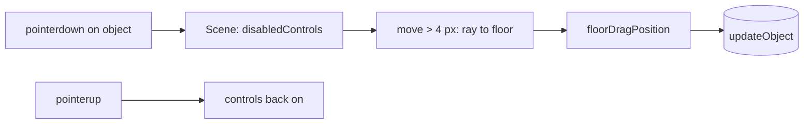

# Handoff: PR-107 / card pending (T-132 follow-up, part C)

- **PR:** https://github.com/PegasusXLab/main/pull/107 (branch `feat/editor-object-drag-3d`)
- **Stacked on #104.** Base is `feat/editor-live-preview-reland`. Devops: after #104 merges, retarget #107 to `main` (`gh pr edit 107 --base main`) **before** deleting #104's branch, or GitHub auto-closes #107.
- **Overlap with #102** (camera inertia re-land, other session): both touch `CameraRig.tsx` / `LookControls.tsx`. Whichever merges second rebases. On top of #102's inertia, `disabledControls` must also end the drag (#102 has an `isDragging` + coasting path).
- **Reviewer:** reviewer-2

## Builder notes
### What changed
3D object drag in the editor (Top-down, POV, split, preview), with the closed #105's two bugs fixed:
1. Selection stays on click (#105 selected on pointerdown and broke TourView's drag-vs-click guard, public tour included). Viewers without `onObjectDrag` render the same group as `main`.
2. `LookControls` resets `isDragging` when disabled, so the camera can't keep following a button-less pointer after an object drag.

`floorDragPosition()` reuses the 2D marker rules (0.1 m snap, Shift free, margin + half the footprint).
### Diagram

### How to test
1. `/edit/local` → add a Marble bust → Top-down: drag the bust. It follows the cursor on the floor, the camera holds still, and it stops at the room edges. A plain click selects it; dragging the floor still orbits.
2. 3D POV: drag the bust sideways, release, move the mouse without a button. The view must not turn. Then look-drag on a wall: the view turns.
3. Publish and open `/g/<id>`: a look-drag that starts on the sculpture must not fly to it (unchanged viewer path).

Evidence at 79de67ef: vitest 88/687 green, tsc clean, lint 0 errors, chromium e2e 12/12. Scripted headless checks recorded in the PR body.
## Review rounds
### Round 1
**Verdict** / **Blocking issues** / **Non-blocking suggestions** / **What I tested**
## DevOps notes
CI result / merge commit / release note
