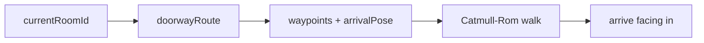

# Handoff: PR-109 / card pending (tour movement)

- **PR:** https://github.com/PegasusXLab/main/pull/109 (branch `feat/tour-movement`)
- **Card:** pending (requested from the senior 2026-10-11 02:19Z). Vic's request: fluid movement, real 360° drag, doorway hover cue, clean transitions, no "weird direction" travel.
- **Reviewer:** reviewer-2 (or reviewer-3 as overflow)

## Builder notes
### What changed
- Travel walks through doorways (BFS route from the room the camera stands in), facing where it walks, and arrives a step into the new room facing in. It used to be a straight 1 s slide to the room's south-wall viewpoint, cutting across walls.
- Heading is yaw/pitch with drag-look and sway as offsets: no roll when facing E/W, and no snap when travel starts.
- Mouse sway (mouse only; off with reduced motion). Doorway hover cue (light pool, chevrons, "Enter <room>", pointer cursor). New TourNav pill. Arrow keys fixed (they were inverted).
### Diagram

### How to test
1. Publish the sample (or `/edit/local` → 3D POV). Hover the Entrance's east doorway: you get the cue and a pointer cursor. Click it: the camera turns, walks through and faces into East Hall.
2. In East Hall click the "South Room" dot: it walks back through the Entrance and through the south doorway.
3. Drag-look east, then drag up/down: no roll. Move the mouse without a button: gentle sway. Arrow keys: Right looks right.
4. Click an artwork, then close the plaque: it returns to where you stood (not the south-wall view).
5. OS reduced motion: no sway, short walks.

Evidence at 49b083de (+ counter fix): vitest 715 green, tsc clean, lint 0 errors, chromium e2e 16/16 + new tour-nav spec.
## Review rounds
### Round 1
**Verdict** / **Blocking issues** / **Non-blocking suggestions** / **What I tested**
## DevOps notes
CI result / merge commit / release note
