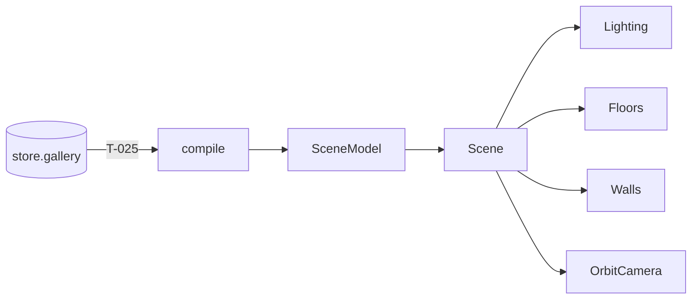

# Handoff: PR-11 / T-013 (stacked on PR #10)
## Builder notes
### What changed
**`src/viewer3d/`: `Scene`, `Floors`, `Walls` and `Lighting` (plus `OrbitCamera` exported from Scene.tsx).**
- **Scene:** `<Scene model={scene} currentRoomId? onFloorClick? className? />` reads only the SceneModel.
  - On-demand rendering, antialias off, DPR 1 below 1024 px wide (R1).
  - Suspense per subsystem (R2).
  - Lighting comes from `LIGHTING_PRESETS[currentRoom.lighting]` (R7).
- **Walls:** one merged mesh per room, rebuilt only when that room's pieces change. Materials are shared per color, and everything is disposed. Walls never raycast (R10).
- **Floors:** one shared plane, one material per preset (`FLOOR_COLORS`). Floors are the only clickable meshes.
- **OrbitCamera:** drei `OrbitControls`, no damping (because we render on demand), can't go below the floor. CameraRig replaces it in Sprint 2.

**For builder-2 (T-025):**
```tsx
const Scene = dynamic(() => import("@/viewer3d/Scene").then((m) => m.Scene), { ssr: false });
const gallery = useGalleryStore((s) => s.gallery);
const { scene } = useMemo(() => compile(gallery), [gallery]);
<Scene model={scene} className="h-full w-full" />
```
The parent must have a height, because the Canvas fills its parent.

### Diagram

### How to test
```bash
git fetch origin && git switch feat/T-013-renderer && npm ci
npm run lint && npm run typecheck && npm test
```
**Visual check (no page on main yet; T-025 adds it):** add a throwaway `src/app/dev-scene/page.tsx`, and don't commit it.
- It's a client component rendering `<div style={{width:"100vw",height:"100vh"}}><Scene model={compile(sampleGallery()).scene} /></div>`.
- Run `npm run dev` and open `/dev-scene`.
- **Expect:** 3 rooms (wood / concrete / marble floors) with light / blue-grey / dark walls, and doorway gaps between the Entrance and both neighbors. Dragging orbits and the wheel zooms.
- **DPR:** at a window under 1024 px wide, `document.querySelector("canvas").width` equals the CSS width.

## Review rounds
### Round 1
**Verdict** / **Blocking issues** / **Non-blocking suggestions** / **What I tested**
## DevOps notes
CI result / merge commit / release note
