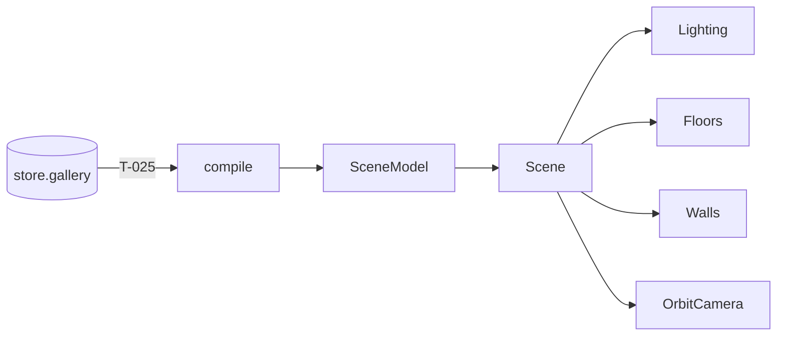

# Handoff: PR-11 / T-013 (stacked on PR #10)
## Builder notes
### What changed
**`src/viewer3d/`: `Scene`, `Floors`, `Walls` and `Lighting` (plus `OrbitCamera` exported from Scene.tsx).**
- **Scene:** `<Scene model={scene} currentRoomId? onFloorClick? className? />` reads only the SceneModel.
  - On-demand rendering, antialias off, DPR 1 below 1024 px wide (R1).
  - Suspense per subsystem (R2).
  - Lighting comes from `LIGHTING_PRESETS[currentRoom.lighting]` (R7).
- **Walls:** one merged mesh per room, rebuilt only when that room's pieces change. Materials are shared per color, and everything is disposed. Walls never raycast (R10).
- **Floors:** one shared plane, one material per preset (`FLOOR_COLORS`). Floors are the only clickable meshes.
- **OrbitCamera:** drei `OrbitControls`, no damping (because we render on demand), can't go below the floor. CameraRig replaces it in Sprint 2.

**For builder-2 (T-025):**
```tsx
const Scene = dynamic(() => import("@/viewer3d/Scene").then((m) => m.Scene), { ssr: false });
const gallery = useGalleryStore((s) => s.gallery);
const { scene } = useMemo(() => compile(gallery), [gallery]);
<Scene model={scene} className="h-full w-full" />
```
The parent must have a height, because the Canvas fills its parent.

### Diagram

### How to test
```bash
git fetch origin && git switch feat/T-013-renderer && npm ci
npm run lint && npm run typecheck && npm test
```
**Visual check (no page on main yet; T-025 adds it):** add a throwaway `src/app/dev-scene/page.tsx`, and don't commit it.
- It's a client component rendering `<div style={{width:"100vw",height:"100vh"}}><Scene model={compile(sampleGallery()).scene} /></div>`.
- Run `npm run dev` and open `/dev-scene`.
- **Expect:** 3 rooms (wood / concrete / marble floors) with light / blue-grey / dark walls, and doorway gaps between the Entrance and both neighbors. Dragging orbits and the wheel zooms.
- **DPR:** at a window under 1024 px wide, `document.querySelector("canvas").width` equals the CSS width.

## Review rounds
### Round 1 (reviewer, 2026-10-10): APPROVED

**Verdict: APPROVED**, provided CI is green once the PR is retargeted to `main` (ADR-010 gate).

**Blocking issues**
None.

**Non-blocking suggestions**
1. **One lighting preset for the whole scene** (`Scene.tsx:91-94`): it comes from `currentRoomId`, or the first room by default. In the preview every room shows the Entrance's "gallery" lighting, so East Hall's "warm" and South Room's "moody" aren't visible yet. That matches the card's "one hemisphere + one directional light" and plan.md §7's "few lights", so it's not blocking. Per-room looks are F11 (Sprint 3), where blending between presets is planned.
2. **The console shows `THREE.Clock: This module has been deprecated`** on load. It comes from R3F 9.8 with three 0.186, not from our code, so it's harmless. Revisit if a later R3F release fixes it.
3. **`RoomWalls` builds its change signature with `JSON.stringify(pieces)` on every render** (`Walls.tsx:52`). That's fine at demo sizes. If galleries grow, a cheaper key (e.g. join the numbers) would do.

**What I tested** (commit on `feat/T-013-renderer`, stacked on #10, in a separate worktree)
- **Checks:** lint, typecheck, test and format:check clean locally. No CI yet (stacked base). Only the 4 `src/viewer3d/` files changed.
- **Code against the card:**
  - it reads only the `model` prop; `LIGHTING_PRESETS` is static data;
  - `frameloop="demand"`; DPR 1 below 1024 px, else `[1, 2]`; antialias off; one Suspense boundary per subsystem;
  - one merged mesh per room, with geometry disposed on change or unmount;
  - wall materials shared per color, floor geometry and materials shared per preset, all disposed;
  - walls have `raycast` disabled;
  - OrbitCamera is its own component.
  - `wallBox` puts each piece inside its room for n/e/s/w, matching ADR-001's inset.
- **Playwright UAT** (Chromium with SwiftShader WebGL, a temporary harness page only):
  - **Render:** the fixture renders 3 rooms with their wall colors, wood and marble floors visible, and **doorway gaps** (the Entrance's wood floor shows through the opening in South Room's north wall).
  - **Camera:** dragging orbits and the wheel zooms.
  - **On-demand rendering:** **0** `requestAnimationFrame` calls during 1.5 s idle.
  - **Pixel density:** at 1280 px @2x the canvas is 2560 px wide (DPR 2); at **900 px @2x it's 900 px** (capped at 1).
  - **Clicks:** clicking South Room's floor gives `room-south`; clicking the Entrance floor, directly or through the doorway, gives `room-entrance`; clicking a wall or the background does nothing.
  - **Console:** no errors, only the upstream Clock deprecation warning and SwiftShader driver messages.

## DevOps notes
CI result / merge commit / release note
