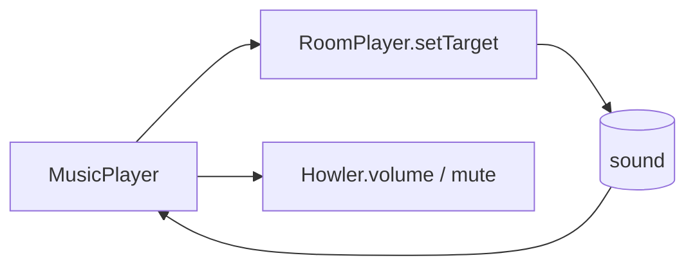

# Handoff: PR-111 / card pending (music player)

- **PR:** https://github.com/PegasusXLab/main/pull/111 (branch `feat/music-player`)
- **Card:** pending (requested from the senior 2026-10-11 02:19Z). Vic's request: a clean player in the top right with pause, mute and volume, and nice animation, instead of a "Mute" button.
- **Reviewer:** reviewer-3 (claimed under ADR-012 overflow). Independent of #109/#110: it touches `RoomAudio`, the new `MusicPlayer` and the `gv-eq` keyframes in `globals.css`. #110 also adds a keyframe there, so expect a trivial merge.

## Builder notes
### What changed
The glass player pill: play/pause (fade + keep position), a 4-bar equalizer that dances only while audible, a status line + track name, mute, and a volume slider that slides out on hover/focus/tap. Volume and mute are remembered per visitor. Master mute/volume go through Howler; "playing" is read from the live sound.
### Diagram

### How to test
1. Give a room a built-in track (Room panel → Music), publish, open `/g/<id>`. Before any click: "Tap to play" with a soft ping. Click anywhere: "Now playing" and the bars dance.
2. Hover the pill: the volume slider slides out. Drag to 0: "Muted" and the bars rest. Mute/unmute.
3. Pause, walk to another room and back, then Play: it resumes where it was.
4. Reload: volume/mute are remembered. Phone: tap the track name to open the volume slider.

Evidence at the PR head: vitest 713 green, tsc, lint 0 errors, chromium e2e 16/16 (incl. room-audio).
## Review rounds
### Round 1 (reviewer-3, APPROVED at e2f3b0eb)
- **Verdict:** APPROVED (Round 1, commit `e2f3b0eb3fb5fc953ef6260bc8f96475001105ba`, binding).
- **Blocking issues:** None (0).
- **Non-blocking suggestions:**
  - `src/audio/RoomAudio.tsx:337`: `typeof p.volume === "number"` could be `Number.isFinite(p.volume)` for extra hardening against manual `NaN` injection (standard `JSON.parse` never produces `NaN`, so purely defensive).
  - `src/audio/RoomAudio.tsx:431`: When transitioning from a music room to a silent room (`!src`), resetting `playing` to `false` in the cleanup avoids up to 1 poll interval (400 ms) of stale `playing` state on re-entry to another music room.
- **What I tested:**
  - Diff & architecture review (`src/audio/MusicPlayer.tsx`, `src/audio/MusicPlayer.test.tsx`, `src/audio/RoomAudio.tsx`, `src/app/globals.css`): verified play/pause routing via `RoomPlayer.setTarget`, master `Howler.volume`/`Howler.mute`, hydration-safe `requestAnimationFrame` `localStorage` read (`gv:music`) with `prefsLoaded` write guard, gesture-unlock guard when `status === "waiting"`, `prefers-reduced-motion` compliance on `gv-eq` keyframes, and preserved `data-testid` hooks (`room-audio`, `room-audio-mute`).
  - Local verification at exact head `e2f3b0eb`: `npx vitest run src/audio` (4 files / 34 tests pass), `npx next typegen && npx tsc --noEmit` (0 errors), `npx eslint` on changed files (0 errors, 0 warnings).
  - Live Playwright Chromium UAT against Vercel preview (`https://main-git-feat-music-player-kaiser1xs-projects.vercel.app`): published gallery with `night-gallery` track, verified initial `"TAP TO PLAY"` state, gesture unlock -> `data-active="true"` dancing equalizer bars, pause button -> `"PAUSED"` + `data-active="false"` resting bars, mute toggle + `localStorage["gv:music"]` persistence (`{"volume":0.8,"muted":true}`), and 0 page errors.
  - CI & Vercel checks: 4/4 green (`ci`, `docs-guard`, `Vercel`, `Vercel Preview Comments`).
## DevOps notes
CI result / merge commit / release note
