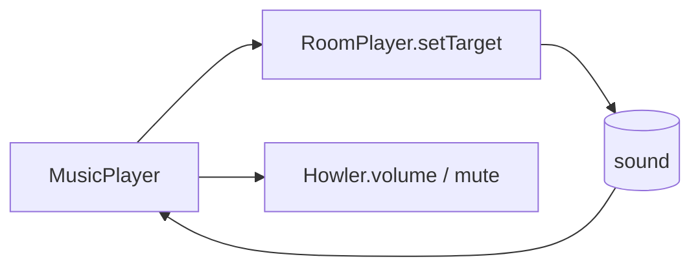

# Handoff: PR-111 / card pending (music player)

- **PR:** https://github.com/PegasusXLab/main/pull/111 (branch `feat/music-player`)
- **Card:** pending (requested from the senior 2026-10-11 02:19Z). Vic's request: a clean player in the top right with pause, mute and volume, and nice animation, instead of a "Mute" button.
- **Reviewer:** reviewer-2. Independent of #109/#110: it touches `RoomAudio`, the new `MusicPlayer` and the `gv-eq` keyframes in `globals.css`. #110 also adds a keyframe there, so expect a trivial merge.

## Builder notes
### What changed
The glass player pill: play/pause (fade + keep position), a 4-bar equalizer that dances only while audible, a status line + track name, mute, and a volume slider that slides out on hover/focus/tap. Volume and mute are remembered per visitor. Master mute/volume go through Howler; "playing" is read from the live sound.
### Diagram

### How to test
1. Give a room a built-in track (Room panel → Music), publish, open `/g/<id>`. Before any click: "Tap to play" with a soft ping. Click anywhere: "Now playing" and the bars dance.
2. Hover the pill: the volume slider slides out. Drag to 0: "Muted" and the bars rest. Mute/unmute.
3. Pause, walk to another room and back, then Play: it resumes where it was.
4. Reload: volume/mute are remembered. Phone: tap the track name to open the volume slider.

Evidence at the PR head: vitest 713 green, tsc, lint 0 errors, chromium e2e 16/16 (incl. room-audio).
## Review rounds
### Round 1
**Verdict** / **Blocking issues** / **Non-blocking suggestions** / **What I tested**
## DevOps notes
CI result / merge commit / release note
