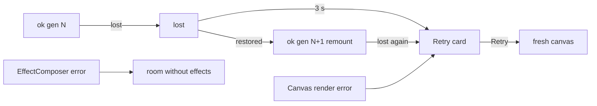

# Handoff: PR-115 / T-157
## Builder notes
Built by senior (acting as builder), Quang-approved 2026-10-10 ~23:50 EDT. Branch `feat/T-157-viewer-crash-guard`, commit 33c6062d.
### What changed
- `src/viewer3d/ViewerErrorBoundary.tsx` (new):
  - `ViewerErrorBoundary`, which warns once and takes a fallback that is either a node or a reset function;
  - `nextGLHealth`, a pure reducer for context loss whose events carry the canvas generation;
  - `SceneFallback`, the "couldn't start · Retry" card.
- `Atmosphere.tsx`: the EffectComposer is in a boundary with `fallback={null}`, so a failure drops the effects and keeps the room.
- `Scene.tsx`: `Scene` is now the guard and the old body is `SceneCanvas`. Changes:
  - render error → Retry card;
  - context lost → preventDefault; restored → remount once; second loss or no restore within 3 s → Retry card;
  - effects mount only after `onCreated` has checked the GL (`glChecked`), so software GL never runs the composer on its first frame.
- **Gotcha found and fixed:** R3F 9.8 tears a replaced canvas down synchronously inside the commit and calls `forceContextLoss()`. That fires `webglcontextlost` on the OLD canvas, before passive effects clean up, so a `mounted` ref doesn't help. Tagging events with the canvas generation, and having the reducer ignore stale ones, does.
### Diagram

### How to test
1. Run `npm test` (753 pass), `npm run lint` and `npm run build`.
2. Open a published `/g/<id>` on the preview and walk it. It should look the same as main (effects on, on a real GPU).
3. In the devtools console:
   ```js
   x = document.querySelector('canvas').getContext('webgl2').getExtension('WEBGL_lose_context');
   x.loseContext();
   setTimeout(() => x.restoreContext(), 500);
   ```
   The room comes back with a fresh canvas.
4. Run `loseContext()` again with no restore. After about 3 s the Retry card shows and the HUD still works. Click Retry and the room comes back.
5. Run publish-view e2e with `--repeat-each=10` against the preview and post the pass count on the PR.

Evidence from senior: real-GPU runs of steps 3–4 passed (RTX 3090 Ti, ANGLE D3D11), and production had 10/10 cold loads before this PR. The phone check is still manual (Quang).
## Review rounds
### Round 1
**Verdict** / **Blocking issues** / **Non-blocking suggestions** / **What I tested**
## DevOps notes
CI result / merge commit / release note
