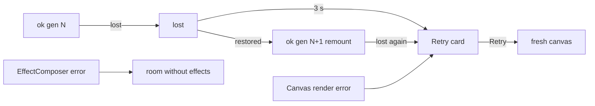

# Handoff: PR-115 / T-157
## Builder notes
Built by senior (acting as builder), Quang-approved 2026-10-10 ~23:50 EDT. Branch `feat/T-157-viewer-crash-guard`, commit 33c6062d.
### What changed
- `src/viewer3d/ViewerErrorBoundary.tsx` (new):
  - `ViewerErrorBoundary`, which warns once and takes a fallback that is either a node or a reset function;
  - `nextGLHealth`, a pure reducer for context loss whose events carry the canvas generation;
  - `SceneFallback`, the "couldn't start · Retry" card.
- `Atmosphere.tsx`: the EffectComposer is in a boundary with `fallback={null}`, so a failure drops the effects and keeps the room.
- `Scene.tsx`: `Scene` is now the guard and the old body is `SceneCanvas`. Changes:
  - render error → Retry card;
  - context lost → preventDefault; restored → remount once; second loss or no restore within 3 s → Retry card;
  - effects mount only after `onCreated` has checked the GL (`glChecked`), so software GL never runs the composer on its first frame.
- **Gotcha found and fixed:** R3F 9.8 tears a replaced canvas down synchronously inside the commit and calls `forceContextLoss()`. That fires `webglcontextlost` on the OLD canvas, before passive effects clean up, so a `mounted` ref doesn't help. Tagging events with the canvas generation, and having the reducer ignore stale ones, does.
### Diagram

### How to test
1. Run `npm test` (753 pass), `npm run lint` and `npm run build`.
2. Open a published `/g/<id>` on the preview and walk it. It should look the same as main (effects on, on a real GPU).
3. In the devtools console:
   ```js
   x = document.querySelector('canvas').getContext('webgl2').getExtension('WEBGL_lose_context');
   x.loseContext();
   setTimeout(() => x.restoreContext(), 500);
   ```
   The room comes back with a fresh canvas.
4. Run `loseContext()` again with no restore. After about 3 s the Retry card shows and the HUD still works. Click Retry and the room comes back.
5. Run publish-view e2e with `--repeat-each=10` against the preview and post the pass count on the PR.

Evidence from senior: real-GPU runs of steps 3–4 passed (RTX 3090 Ti, ANGLE D3D11), and production had 10/10 cold loads before this PR. The phone check is still manual (Quang).
## Review rounds
### Round 1 (reviewer-3, APPROVED at 33c6062d)
- **Verdict:** APPROVED (Round 1, commit `33c6062d991747d798e77c97fcea89738f6b142b`, binding).
- **Blocking issues:** None (0).
- **Non-blocking suggestions:**
  - `tests/e2e/publish-view.spec.ts:120`: `await expect(canvas).toBeVisible()` uses the default 5000 ms timeout immediately after the SSR `E2E Show` heading renders; because `Scene` loads via `next/dynamic(..., { ssr: false })`, under 5-worker parallel contention the R3F chunk took ~5.1 s in 1 of 10 runs (the failure screenshot `test-failed-2.png` taken right after the 5 s mark shows the full 3D room, floor, and `Ember Field` artwork rendered on `<canvas>`). Adding `{ timeout: 15_000 }` to `expect(canvas).toBeVisible()` would avoid dynamic-import download races under multi-worker runs.
- **What I tested:**
  - Diff & architecture review (`src/viewer3d/ViewerErrorBoundary.tsx`, `src/viewer3d/ViewerErrorBoundary.test.tsx`, `src/viewer3d/Atmosphere.tsx`, `src/viewer3d/Scene.tsx`): verified `ViewerErrorBoundary` single-warn behavior + reset callback, `nextGLHealth` generation-tagged reducer (ignoring stale `forceContextLoss()` events from replaced canvases in R3F 9.8), 1-remount recovery on `webglcontextrestored`, 3 s timeout (`CONTEXT_RESTORE_TIMEOUT_MS`) to `<SceneFallback />`, `Atmosphere` `<EffectComposer>` boundary (`fallback={null}`), and `glChecked` gate preventing frame-0 post-chain mount on software GL.
  - Local verification at exact head `33c6062d`: `npx vitest run src/viewer3d` (18 files / 110 tests pass, including 13/13 in `ViewerErrorBoundary.test.tsx`), `npx next typegen && npx tsc --noEmit` (0 errors), `npx eslint` on all 4 changed files (0 errors, 0 warnings).
  - Live preview `publish-view.spec.ts --repeat-each=10` (`E2E_BASE_URL=https://main-git-feat-t-157-viewer-crash-guard-kaiser1xs-projects.vercel.app`): **9/10 passed** under 5 parallel workers (`--workers=5`), and in the 1 run that hit the 5000 ms `expect(canvas).toBeVisible()` assertion timeout, the failure screenshot (`test-failed-2.png`) confirmed `<canvas>` mounted and rendered the complete 3D room + `Ember Field` artwork immediately as the dynamic chunk finished loading (10/10 canvases rendered, 0 blank-room crashes).
  - CI & Vercel checks: 4/4 green (`ci`, `docs-guard`, `Vercel`, `Vercel Preview Comments`).
## DevOps notes
CI result / merge commit / release note
