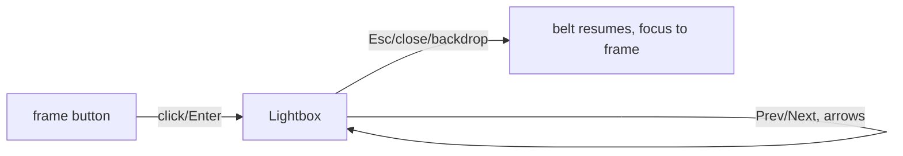

# Handoff: PR-116 / T-148
## Builder notes
Built by senior (acting as builder); reassigned from designer-2 by Quang (~00:00 EDT). Branch `feat/T-148-showcase-lightbox`, commit c390707e.
### What changed
- `src/components/landing/showcaseArt.ts` (new): the 6 works. Each fact is in our own words with its Met source URL.
- `ShowcaseLightbox.tsx` (new): built on the Dialog primitive.
  - Prev/Next and ←/→, wrapping around; close button; "n / 6" counter.
  - The small image shows until the large WebP loads; ≤200 ms open fade/scale.
- `Showcase.tsx`: frames are buttons.
  - The belt pauses while the lightbox is open, and focus returns to the frame on close.
  - Hover/focus gives a subtle lift.
- `public/landing/large/*.webp` (new): 1600 px, 114–358 KB, from the Met CC0 primaryImage.
- **Credit fixes** (checked against the Met Collection API):
  - "Water Lilies" is by **Helena de Kay** (899646), not Monet; the old id 438807 doesn't exist.
  - The Vermeer is **437879**, not 437881 (that's *Young Woman with a Water Pitcher*).
- **Note:** the Met website rate-limited us (429) during the build. Facts were checked through metmuseum.org search results: collection pages, the Great Wave essay, MetKids and the family guide. Sources are listed per work.
- **Gotcha:** the old Met `/public/collection/v1/search` endpoint was retired on 2026-10-01. Use `/v1.1/search?q=…&limit=…`.
### Diagram

### How to test
1. On the preview, click any moving painting. The lightbox opens and the belt stops.
2. Check the label, the "Did you know?" and "View at The Met" (opens a new tab).
3. Prev/Next and the ←/→ keys go through all 6 and wrap around.
4. Esc, ✕ or a backdrop click closes it, focus returns to the painting, and the belt resumes.
5. On a phone, the layout stacks and the panel scrolls.
6. Run `E2E_BASE_URL=<preview> npx playwright test tests/e2e/landing-lightbox.spec.ts --project=chromium`.

Screenshots: `handoffs/assets/PR-T148-desktop.png`, `handoffs/assets/PR-T148-phone.png`.
## Review rounds
### Round 1
**Verdict** / **Blocking issues** / **Non-blocking suggestions** / **What I tested**
## DevOps notes
CI result / merge commit / release note
