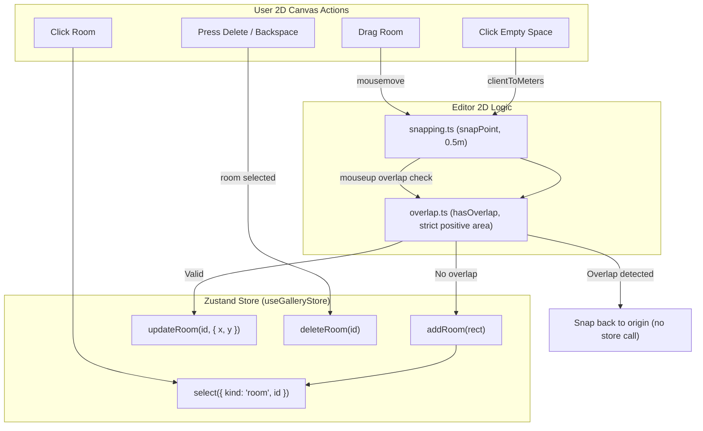

# Handoff: PR-13 / T-021
## Builder notes
### What changed
Implemented the core 2D room interactions on the SVG canvas (`feat/T-021-rooms-2d`, PR #13):

1. **Snapping (`src/editor2d/snapping.ts`):**
   - Pure grid snapping helpers (`snapPoint`, `snapRoom`) using `@/lib/schema/geom` (`GRID = 0.5`, `snap`, `snapRect`) with zero floating-point comparisons of their own.
2. **Overlap detection (`src/editor2d/overlap.ts`):**
   - Strict positive-area overlap check (`hasOverlap`, `findOverlappingRoom`) using `rectsOverlap` from `@/lib/schema/geom`.
   - Allows touching rooms (shared edges and shared corners).
   - Supports `ignoreRoomId` to exclude the room being moved or resized.
3. **Room component (`src/editor2d/RoomShape.tsx`):**
   - Interactive SVG room displaying room name and dimensions (`${w} × ${d} m`).
   - Selected styling (3px blue outline `#2563eb`).
   - Drag preview and overlap error styling (red outline `#ef4444` and red tint `#fef2f2`).
   - Stops event propagation so room clicks do not trigger canvas empty-space actions.
4. **Canvas integration (`src/editor2d/Canvas.tsx`):**
   - **Click empty space:** Adds a 6 × 6 m room snapped to 0.5 m (calls `addRoom` and selects the new room). Refuses addition and deselects if the candidate rect overlaps an existing room.
   - **Click room:** Selects the room (`select({ kind: "room", id })`).
   - **Drag room:** Dragging moves the room snapped to the 0.5 m grid. When released, if the proposed position overlaps another room, the move is rejected and the room snaps back to its original position without modifying the store. If valid, calls `updateRoom`.
   - **Delete key:** Pressing `Delete` or `Backspace` (outside of text inputs/textareas) calls `deleteRoom` for the selected room. Protected by store rules (refuses deleting the last room). Pressing `Escape` deselects.
5. **Unit tests:**
   - `src/editor2d/snapping.test.ts`: snapping points, rooms, and coordinates.
   - `src/editor2d/overlap.test.ts`: touching edges, touching corners, strict positive area overlap, and `ignoreRoomId`.
   - `src/editor2d/RoomShape.test.tsx`: SVG rendering, selection highlight, drag preview with overlap error styling.
   - `src/editor2d/Canvas.test.tsx`: room rendering and selection in Canvas.

### Diagram


### How to test
```bash
git fetch origin && git switch feat/T-021-rooms-2d
npm ci
npm test
npm run typecheck
npm run lint
npm run format:check
```

Expected:
- 16 test files, 153/153 unit tests pass.
- TypeScript route types & tsc clean (0 errors).
- ESLint clean (0 errors, 0 warnings).
- Prettier clean.

## Review rounds
<!-- Reviewer will populate this section -->
