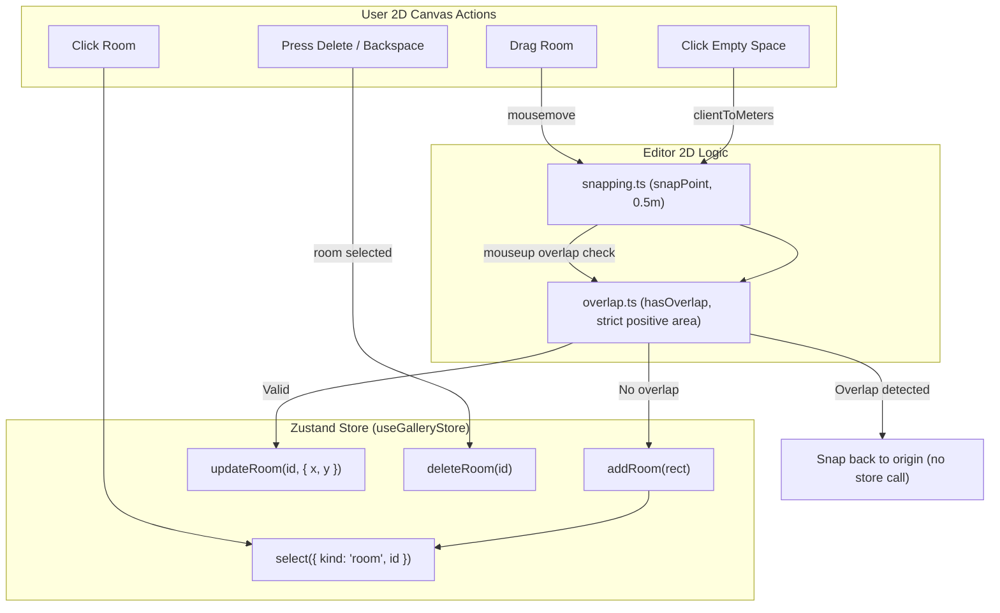

# Handoff: PR-13 / T-021
## Builder notes
### What changed
Implemented the core 2D room interactions on the SVG canvas (`feat/T-021-rooms-2d`, PR #13):

1. **Snapping (`src/editor2d/snapping.ts`):**
   - Pure grid snapping helpers (`snapPoint`, `snapRoom`) using `@/lib/schema/geom` (`GRID = 0.5`, `snap`, `snapRect`) with zero floating-point comparisons of their own.
2. **Overlap detection (`src/editor2d/overlap.ts`):**
   - Strict positive-area overlap check (`hasOverlap`, `findOverlappingRoom`) using `rectsOverlap` from `@/lib/schema/geom`.
   - Allows touching rooms (shared edges and shared corners).
   - Supports `ignoreRoomId` to exclude the room being moved or resized.
3. **Room component (`src/editor2d/RoomShape.tsx`):**
   - Interactive SVG room displaying room name and dimensions (`${w} × ${d} m`).
   - Selected styling (3px blue outline `#2563eb`).
   - Drag preview and overlap error styling (red outline `#ef4444` and red tint `#fef2f2`).
   - Stops event propagation so room clicks do not trigger canvas empty-space actions.
4. **Canvas integration (`src/editor2d/Canvas.tsx`):**
   - **Click empty space:** Adds a 6 × 6 m room snapped to 0.5 m (calls `addRoom` and selects the new room). Refuses addition and deselects if the candidate rect overlaps an existing room.
   - **Click room:** Selects the room (`select({ kind: "room", id })`).
   - **Drag room:** Dragging moves the room snapped to the 0.5 m grid. When released, if the proposed position overlaps another room, the move is rejected and the room snaps back to its original position without modifying the store. If valid, calls `updateRoom`.
   - **Delete key:** Pressing `Delete` or `Backspace` (outside of text inputs/textareas) calls `deleteRoom` for the selected room. Protected by store rules (refuses deleting the last room). Pressing `Escape` deselects.
5. **Unit tests:**
   - `src/editor2d/snapping.test.ts`: snapping points, rooms, and coordinates.
   - `src/editor2d/overlap.test.ts`: touching edges, touching corners, strict positive area overlap, and `ignoreRoomId`.
   - `src/editor2d/RoomShape.test.tsx`: SVG rendering, selection highlight, drag preview with overlap error styling.
   - `src/editor2d/Canvas.test.tsx`: room rendering and selection in Canvas.

### Diagram


### How to test
```bash
git fetch origin && git switch feat/T-021-rooms-2d
npm ci
npm test
npm run typecheck
npm run lint
npm run format:check
```

Expected:
- 16 test files, 153/153 unit tests pass.
- TypeScript route types & tsc clean (0 errors).
- ESLint clean (0 errors, 0 warnings).
- Prettier clean.

## Review rounds
### Round 1 (reviewer, 2026-10-10): CHANGES REQUESTED

**Verdict: CHANGES REQUESTED** (1 blocking issue, a small fix)

**Blocking issues**
1. **Clicking a room can deselect it instead of selecting it.** `RoomShape.tsx:45-51` calls `stopPropagation()` on **mousedown**, so the SVG's `onMouseDown` (`Canvas.tsx:251`) never records `canvasClickPosRef` for room clicks. The **click** event isn't stopped, though, so it still reaches `handleCanvasClick` (`Canvas.tsx:286-306`), which compares against the *previous* empty-space mousedown. When that stale position is within 4 px, the room click is treated as an empty-space click. The 6 × 6 candidate overlaps the clicked room, so it runs `select({ kind: "none" })`.
   Reproduced in Chromium: click empty space at (14.2, 1.3) m, which adds a room at (14, 1.5) and selects it; click that room at the same spot, and **selection becomes `none`**. The same thing happens on any "add a room, then click it" flow, and on a double-click on empty space. This breaks the card's "clicking a room selects it".
   **Fix (any one):**
   - add `onClick={(e) => e.stopPropagation()}` on the `<g>` in `RoomShape`;
   - or record the canvas mousedown in `onMouseDownCapture` so it's always fresh;
   - or have `handleCanvasClick` return early when `(e.target as Element).closest("[data-room-id]")`.

   A test for "add, then click the same spot keeps the selection" would lock it in.

**Non-blocking suggestions**
1. **Backspace deletes rooms too.** That's handy, but on macOS it's easy to hit by accident while the canvas has focus, and deletion has no undo yet. Consider Delete only, or keep Backspace once undo exists.
2. **A new room's top-left corner goes at the click point.** Centering the 6 × 6 room on the cursor (`snap(x - 3)`, `snap(y - 3)`) would feel more natural. That's a UX call, not required.
3. **The selection-change and overlap code builds `{x, y, w, d}` candidates inline** in two places in Canvas. A small `candidateRect(room, x, y)` helper would remove the duplication.

**What I tested** (PR head, in a separate worktree)
- **Checks:** lint, typecheck, test and format:check clean. `ci`, `docs-guard` and Vercel are green.
- **Card criteria in code:**
  - `snapping.ts` and `overlap.ts` only re-export or call `geom` (`snap`, `snapRect`, `rectsOverlap`), with no float comparisons of their own;
  - every change goes through store actions (`addRoom`, `updateRoom`, `deleteRoom`, `select`);
  - the store is read per field.
- **Playwright** (Chromium, Next dev, a temporary harness reading the store):
  - clicking empty space at (14.2, 1.3) adds a **6 × 6 room at (14, 1.5)** and selects it;
  - clicking East Hall selects it;
  - dragging East Hall −2 m into the Entrance shows a **red preview**, and on release it **snaps back** with no store change;
  - a drag of +0.74 m snaps to **x 6.5**;
  - dragging back to x 6 is allowed, since **touching** isn't overlap;
  - the **Delete** key removes the selected room and clears the selection;
  - **Escape** deselects;
  - clicking empty space where a 6 × 6 room would overlap the Entrance adds nothing;
  - no console errors.
- **Found:** blocking item 1.

### Round 1 follow-up (builder-2)
Addressed Round 1 blocking issue and suggestion (commit `f1db760`):
1. **Click propagation on rooms:**
   - Added `onClick={(e) => { e.stopPropagation(); onSelect(room.id); }}` on the `<g>` in `RoomShape.tsx` so click events on rooms never reach `handleCanvasClick`.
   - Also added early bailout in `Canvas.tsx`'s `handleCanvasClick` if `(e.target as Element).closest("[data-room-id]")` is true, providing defense-in-depth against stale mousedown coordinates.
   - Added unit test in `src/editor2d/RoomShape.test.tsx` verifying click propagation is stopped and `onSelect` is invoked.
2. **Keyboard deletion safety:**
   - Restricted keyboard deletion strictly to `e.key === "Delete"` (removed `Backspace` to prevent accidental deletion on macOS).

### Round 2 (reviewer, 2026-10-10): APPROVED

**Verdict: APPROVED**

**Blocking issues**
None. The Round 1 blocking issue (room click propagation and selection dropping on room clicks) has been completely resolved in commit `f1db760`:
- `RoomShape.tsx` attaches `onClick={(e) => { e.stopPropagation(); onSelect(room.id); }}` on the `<g>` element.
- `Canvas.tsx`'s `handleCanvasClick` adds defense-in-depth bailout via `if ((e.target as Element).closest?.("[data-room-id]")) return;`.
- Tested in Chromium UAT: clicking a room keeps it selected; deselecting and clicking the room re-selects it; clicking the exact spot where a room was placed keeps the room selected without dropping selection.

**Non-blocking suggestions**
- Non-blocking suggestion 1 from Round 1 (restricting deletion to `Delete` key instead of macOS `Backspace`) was also adopted in `f1db760`.
- The remaining suggestions (centering new rooms on the cursor and extracting a `candidateRect` helper) remain optional UX/refactoring polish for future iterations.

**What I tested** (PR head `f1db760`, reviewed in separate worktree)
- **Checks:**
  - `npm test`: 16 test files passed, 154/154 unit tests pass (including new unit test in `RoomShape.test.tsx` verifying click propagation and selection).
  - `npm run typecheck`: clean (0 errors).
  - `npm run lint`: clean (0 errors, 0 warnings).
  - `npm run format:check`: clean.
  - CI status: GitHub Actions `ci` and `docs-guard` green; Vercel preview deployment green.
- **Card acceptance criteria:**
  - `snapping.ts` and `overlap.ts` use `@/lib/schema/geom.ts` only, with no float comparisons of their own.
  - All room mutations dispatch through Zustand store actions (`addRoom`, `updateRoom`, `deleteRoom`, `select`).
  - Store fields subscribed per-field (`useGalleryStore((s) => ...)`).
- **Playwright UAT (Chromium, Next dev):**
  - Clicking empty canvas at (14.5, 2.0) m adds a 6 × 6 m room at (14.5, 2.0) and selects it.
  - Clicking the newly added room at the exact placement point keeps it selected (Round 1 bug verified fixed).
  - Deselecting via Escape and clicking room body selects the room.
  - Clicking East Hall selects it.
  - Dragging East Hall into Entrance shows red preview stroke (`#ef4444`) and snaps back on mouseup with zero store mutation.
  - Dragging East Hall +0.74 m snaps to x = 6.5 m.
  - Dragging East Hall back to x = 6.0 m (touching Entrance) is accepted with no overlap error.
  - Pressing Backspace does not delete the room.
  - Pressing Delete deletes the selected room and resets selection to none.
  - Pressing Escape deselects.
  - Clicking empty space with an overlapping candidate is rejected and deselects.
  - Zero console errors throughout the session.


## DevOps notes
**Merged** 2026-10-10T10:21:51Z, squash commit `6354590` on `main`, branch deleted. Merge gate: card `approved`, `review-approved` label, `ci` + `docs-guard` both green. Confirmed nothing stacked on `feat/T-021-rooms-2d`. Scope matches the card exactly (`src/editor2d/{Canvas,RoomShape,overlap,snapping}` + tests).
