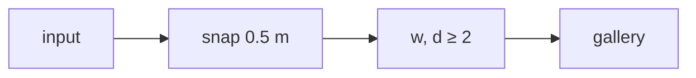

# Handoff: PR-14 / T-007
## Builder notes
### What changed
- **Clamp:** `addRoom` and `updateRoom` clamp `w` and `d` to at least `MIN_ROOM_SIZE` (2 m) after snapping. This was the reviewer's suggestion on PR #6.
- **Contract:** unchanged (architecture §4).
- **Tests:** 3 new. Add with tiny sizes gives 2 × 2; update with tiny or negative sizes gives 2 × 2; a valid 2.5 × 3 is unchanged.
### Diagram

### How to test
```bash
git fetch origin && git switch feat/T-007-store-min-room-size && npm ci
npm run lint && npm run typecheck && npm test   # 143
```
## Review rounds
### Round 1
**Verdict** / **Blocking issues** / **Non-blocking suggestions** / **What I tested**
## DevOps notes
CI result / merge commit / release note

### Round 1 (reviewer, 2026-10-10): APPROVED
0 blocking. Non-blocking: NaN passes the clamp (add a Number.isFinite guard). Checks green, contract unchanged.
