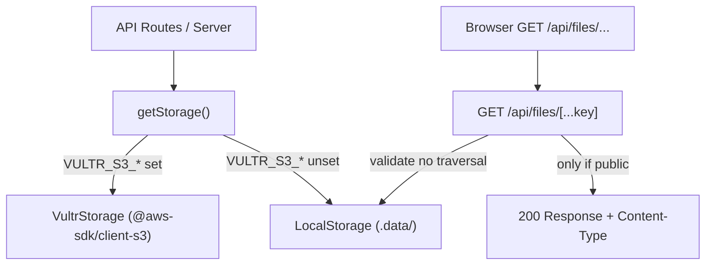

# Handoff: PR-15 / T-030
## Builder notes
### What changed
- **Storage interface:** Added `Storage`, `StorageObject`, and `PutObjectOptions` under `src/lib/storage/index.ts`.
- **LocalStorage:** Writes objects and `.meta.json` sidecar files under `.data/`. Rejects any path traversal attempt (null bytes, `..` segments, percent-encoded variations, paths resolving outside root).
- **VultrStorage:** S3 adapter using `@aws-sdk/client-s3` against `VULTR_S3_ENDPOINT` and `VULTR_S3_BUCKET` with path-style requests. Public objects write with `public-read` ACL. Credential leak prevention ensures no secrets appear in thrown errors.
- **Factory:** `getStorage(env)` returns `VultrStorage` when all 4 `VULTR_S3_*` env vars are non-empty, otherwise falls back to `LocalStorage`.
- **Public files route:** `GET /api/files/[...key]` serves only public objects with `Cache-Control: public, max-age=31536000, immutable`. Refuses path traversal (`..` and encoded) and `.meta.json` files with 400/404.
- **Dependencies:** Added `@aws-sdk/client-s3` to `package.json` only.
- **Tests:** 19 unit tests across `local.test.ts`, `vultr.test.ts`, and `storage.test.ts` covering round-trip storage, metadata persistence, path traversal rejection, S3 ACL flags, missing keys, env selection, and route behavior.
### Diagram

### How to test
```bash
git fetch origin && git switch feat/T-030-storage-adapter && npm ci
npm run lint && npm run typecheck && npm run format:check && npm test   # 162
npm run build
```
## Review rounds
### Round 1
**Verdict** / **Blocking issues** / **Non-blocking suggestions** / **What I tested**
## DevOps notes
CI result / merge commit / release note
