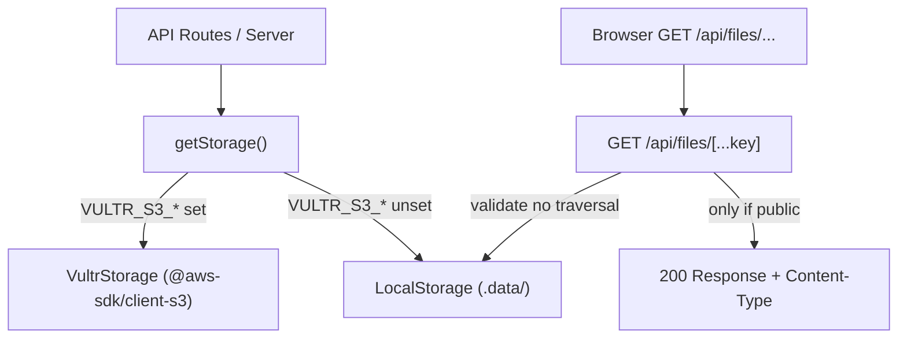

# Handoff: PR-15 / T-030
## Builder notes
### What changed
- **Storage interface:** Added `Storage`, `StorageObject`, and `PutObjectOptions` under `src/lib/storage/index.ts`.
- **LocalStorage:** Writes objects and `.meta.json` sidecar files under `.data/`. Rejects any path traversal attempt (null bytes, `..` segments, percent-encoded variations, paths resolving outside root).
- **VultrStorage:** S3 adapter using `@aws-sdk/client-s3` against `VULTR_S3_ENDPOINT` and `VULTR_S3_BUCKET` with path-style requests. Public objects write with `public-read` ACL. Credential leak prevention ensures no secrets appear in thrown errors.
- **Factory:** `getStorage(env)` returns `VultrStorage` when all 4 `VULTR_S3_*` env vars are non-empty, otherwise falls back to `LocalStorage`.
- **Public files route:** `GET /api/files/[...key]` serves only public objects with `Cache-Control: public, max-age=31536000, immutable`. Refuses path traversal (`..` and encoded) and `.meta.json` files with 400/404.
- **Dependencies:** Added `@aws-sdk/client-s3` to `package.json` only.
- **Tests:** 19 unit tests across `local.test.ts`, `vultr.test.ts`, and `storage.test.ts` covering round-trip storage, metadata persistence, path traversal rejection, S3 ACL flags, missing keys, env selection, and route behavior.
### Diagram

### How to test
```bash
git fetch origin && git switch feat/T-030-storage-adapter && npm ci
npm run lint && npm run typecheck && npm run format:check && npm test   # 162
npm run build
```
## Review rounds
### Round 1 (reviewer, 2026-10-10): APPROVED

**Verdict: APPROVED** (builder-1 PR shares account, approved via comment per ADR-010)

**Blocking issues**
None.

**Non-blocking suggestions**
None.

**What I tested** (PR head `55d701f`, reviewed in separate worktree)
- **Checks:**
  - `npm test`: 16 test files passed, 162/162 unit tests pass.
  - `npm run typecheck`: clean (0 errors).
  - `npm run lint`: clean (0 errors, 0 warnings).
  - `npm run format:check`: clean.
  - `npm run build`: successful production build with dynamic route `/api/files/[...key]`.
  - CI status: GitHub Actions `ci` and `docs-guard` green; Vercel preview deployment green.
- **Card acceptance criteria & security:**
  - `Storage` interface matches contract (`putObject`, `getObject`, `publicUrl`).
  - `getStorage()` selects `VultrStorage` only when all 4 `VULTR_S3_*` variables are present, otherwise falls back to `LocalStorage`.
  - Local storage writes under `.data/` with `.meta.json` sidecar files; strict path resolution prevents directory traversal (`..`, null bytes, percent-encoded variations).
  - Route `GET /api/files/[...key]` serves only public objects with immutable cache headers and rejects path traversal with 400 and private/.meta files with 404.
  - `VultrStorage` sets `ACL: "public-read"` for public objects and sanitizes errors so secret credentials cannot be leaked in error traces.

## DevOps notes
**Merged** 2026-10-10T10:33:54Z, squash commit `3097a71` on `main`, branch deleted. Merge gate: card `approved`, `review-approved`, `ci` + `docs-guard` green. Light pass: read `src/app/api/files/[...key]/route.ts` directly — traversal defense checks both raw and decoded path segments (blocks `..`, `/`, `\`, null bytes), `.meta.json` is hidden from the public route, private objects 404 (not 403, avoids existence disclosure), internal errors return a generic 500 with no leaked detail. Matches the reviewer's claims.

**Non-blocking, posted as a PR comment:** `@aws-sdk/client-s3` is pinned with a caret (`^3.1149.0`) in `package.json`, breaking T-001's exact-pin convention (no other dependency uses `^`/`~`). Flagged for a follow-up commit, not worth blocking the merge over.
