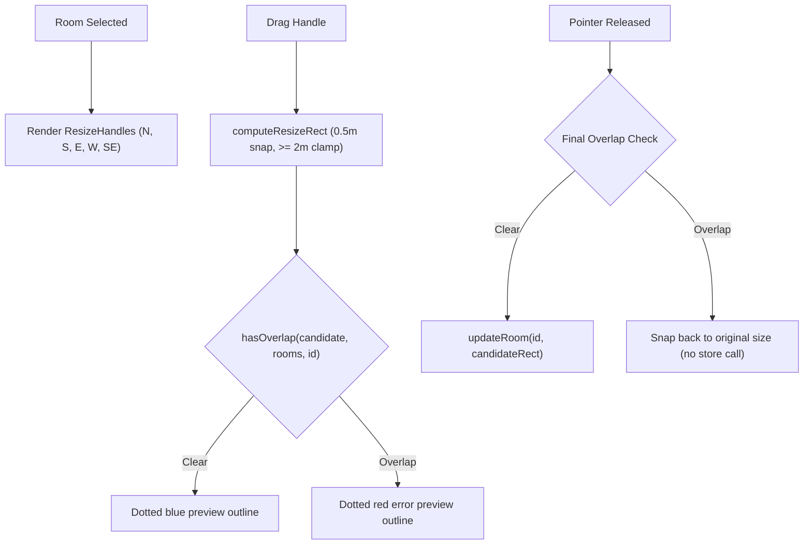

# Handoff: PR-16 / T-022
## Builder notes
### What changed
Implemented interactive room resize handles on the 2D SVG canvas (`feat/T-022-resize-handles`, PR #16):

1. **Resize Handles component & calculation (`src/editor2d/ResizeHandles.tsx`):**
   - Renders 4 edge resize handles (North, South, East, West) and 1 corner resize handle (Southeast ◢ per plan.md §3.2 wireframe) along the boundary of the selected room.
   - Pure `computeResizeRect(original, edge, dxMeters, dyMeters, minSize)` helper:
     - Snaps all dimensions and positions to the 0.5 m grid using `snap` from `./snapping`.
     - Clamps width and depth to at least `MIN_ROOM_SIZE` (2 × 2 m).
     - Correctly anchors opposite edges when resizing from the West (anchors East edge) and North (anchors South edge).
   - Handles stop event propagation on both `onMouseDown` and `onClick` to avoid unintentional room drags or canvas empty-space actions.
2. **Canvas integration (`src/editor2d/Canvas.tsx`):**
   - Renders `ResizeHandles` on the currently selected room when room drag is not active.
   - Coordinates resize dragging via global `mousemove` and `mouseup` window listeners.
   - Displays a live dotted outline preview during resize (`#2563eb` when valid, `#ef4444` with red tint when candidate would overlap another room).
   - Checks overlap against existing rooms via `hasOverlap(candidateRect, rooms, roomId)` from `./overlap.ts`.
   - On release: if no overlap, updates room via store `updateRoom(roomId, candidateRect)`. If overlap detected, rejects the resize and the room snaps back to its original dimensions without updating the store.
3. **Unit tests (`src/editor2d/ResizeHandles.test.tsx`):**
   - Tests pure `computeResizeRect` calculation for East, South, West, North, and Southeast edges including 0.5m snapping and 2m minimum clamping.
   - Tests markup rendering of all 5 handles (`resize-handle-n`, `resize-handle-s`, `resize-handle-w`, `resize-handle-e`, `resize-handle-se`).

### Diagram


### How to test
```bash
git fetch origin && git switch feat/T-022-resize-handles
npm ci
npm test
npm run typecheck
npm run lint
npm run format:check
```

Expected:
- 17 test files, 163/163 unit tests pass.
- TypeScript route types & tsc clean (0 errors).
- ESLint clean (0 errors, 0 warnings).
- Prettier clean.

## Review rounds
<!-- Reviewer will populate this section -->

