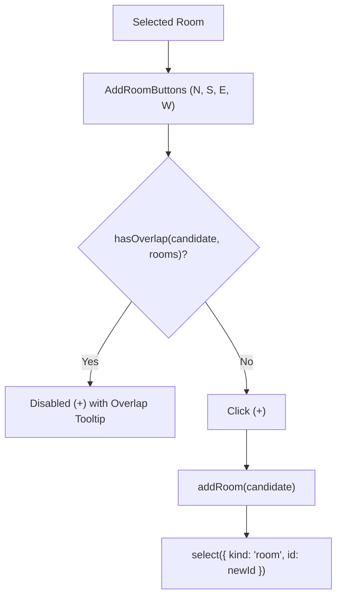

# Handoff: PR-18 / T-023
## Builder notes
### What changed
Implemented adjacent room addition (+) buttons on the 2D SVG canvas (`feat/T-023-add-room-buttons`, PR #18):

1. **Adjacent Room Buttons Component (`src/editor2d/AddRoomButtons.tsx`):**
   - Pure `getAdjacentRoomRect(room, side, depth = 6)`:
     - North: `{ x: room.x, y: room.y - depth, w: room.w, d: depth }` flush against north wall.
     - South: `{ x: room.x, y: room.y + room.d, w: room.w, d: depth }` flush against south wall.
     - East: `{ x: room.x + room.w, y: room.y, w: depth, d: room.d }` flush against east wall.
     - West: `{ x: room.x - depth, y: room.y, w: depth, d: room.d }` flush against west wall.
   - SVG `<AddRoomButtons>` renders 4 circular `+` buttons centered outside each edge of the selected room.
   - Checks `hasOverlap(candidate, rooms)`:
     - When valid: renders blue button (`#2563eb`), hover state, title tooltip "Add room to the <Side>".
     - When overlapping: disables button (`cursor-not-allowed`, opacity 50%, `#e4e4e7` fill, `aria-disabled="true"`, `data-disabled="true"`) with informative title tooltip "Cannot add <Side> room: overlaps existing room".
     - Accessible: includes `role="button"`, `aria-label`, and `aria-disabled`.
     - Event handling: stops propagation on click and mousedown to prevent accidental room dragging or canvas deselection.
2. **Canvas Integration (`src/editor2d/Canvas.tsx`):**
   - Rendered `<AddRoomButtons>` on the selected room alongside `<ResizeHandles>` when not dragging or resizing.
   - On click, invokes `addRoom(candidateRect)` and immediately updates selection to the new room via `select({ kind: "room", id: newId })`.
3. **Unit Tests (`src/editor2d/AddRoomButtons.test.tsx`):**
   - Tests pure `getAdjacentRoomRect` calculation for North, South, East, West edges and custom depth.
   - Tests SVG rendering, accessibility markup, disabled state when candidate overlaps an existing room, and tooltip messaging.

### Diagram


### How to test
```bash
git fetch origin && git switch feat/T-023-add-room-buttons
npm ci
npm test
npm run typecheck
npm run lint
npm run format:check
```

Expected:
- 23 test files, 199/199 unit tests pass.
- TypeScript route types & tsc clean (0 errors).
- ESLint clean (0 errors, 0 warnings).
- Prettier clean.

## Reviewer notes

### Round 1
- **Verdict:** APPROVED
- **Reviewer:** reviewer (Vic)
- **Date:** 2026-10-10
- **Scope reviewed:**
  - `src/editor2d/AddRoomButtons.tsx`
  - `src/editor2d/AddRoomButtons.test.tsx`
  - `src/editor2d/Canvas.tsx`
- **Verification performed:**
  - Typecheck: `npx tsc --noEmit` clean
  - Lint: `npm run lint` clean
  - Format: `npm run format:check` clean
  - Tests: Vitest 23 suites, 199 tests pass
  - Build: `npm run build` succeeds
  - Playwright UAT: verified live SVG overlay on Canvas (`/canvas-test` harness):
    - Entrance room (4x4m) displays 4 directional (+) buttons.
    - East and South buttons correctly detected overlap with East Hall and South Room and showed disabled visual affordance (`opacity-30`, `cursor-not-allowed`, `data-disabled="true"`).
    - North button active; clicking it created adjacent room at (0, -6) with 4x4m dimensions and selected it immediately.
    - Clicking disabled East button resulted in no room created and no state modification.
