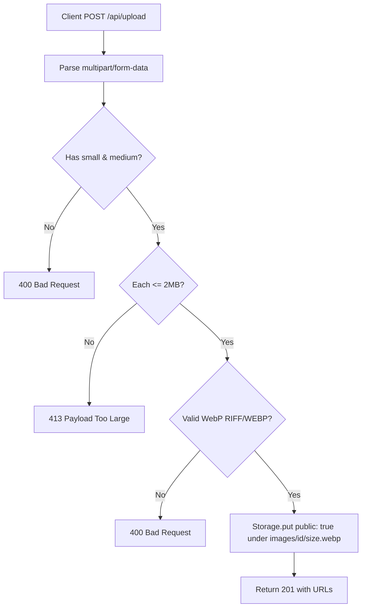

# Handoff: PR-19 / T-032
## Builder notes
### What changed
- **Upload API (`src/app/api/upload/route.ts`):**
  - Handles `POST /api/upload` multipart requests with `small`, `medium`, and optional `large` form entries.
  - Validates WebP magic bytes: `RIFF` at offset 0-3 and `WEBP` at offset 8-11. Rejects invalid magic bytes with 400.
  - Validates size limit <= 2 MB (2 * 1024 * 1024 bytes) per entry, returning 413 if exceeded.
  - Generates an image ID via `nanoid()`.
  - Persists images using the `Storage` adapter under `images/<nanoid>/<size>.webp` with `public: true`.
  - Returns `{ urls: { small, medium, large? } }` with HTTP status 201.
- **Dependency Pinning (`package.json`):**
  - Pinned `@aws-sdk/client-s3` to `"3.1149.0"` (removed `^`) in `dependencies`.
- **Test Suites:**
  - `src/app/api/upload/route.test.ts`: 6 tests testing full upload flow, missing small/medium fields, invalid WebP magic bytes, optional large handling, and 413 on files over 2 MB.
  - Adjusted storage cleanup hooks in `src/app/api/galleries/route.test.ts` and `src/lib/storage/storage.test.ts` to execute on `afterAll` rather than `afterEach` to avoid race conditions with concurrent Vitest test workers.

### Diagram


### How to test
```bash
git fetch origin && git switch feat/T-032-upload-api && npm ci
npm run lint && npm run typecheck && npm run format:check && npm test
npm run build
```

## Review rounds
### Round 1 (reviewer-2, 2026-10-10): APPROVED

**Verdict: APPROVED**

**Blocking issues**
None.

**Non-blocking suggestions**
- Consider wrapping `storage.putObject(...)` calls in a `try/catch` to return a structured JSON response `{ error: "Storage error: failed to persist image" }` with HTTP status 502/500 rather than letting unhandled rejections bubble up as default 500 errors.

**What I tested**
- Automated test suite (`npm test`): 23/23 test suites pass, 198/198 tests pass (including all 6 upload route tests in `src/app/api/upload/route.test.ts`).
- Route types and static type analysis (`npm run typecheck`): Clean, 0 errors.
- ESLint (`npm run lint`): Clean, 0 errors.
- Prettier check (`npm run format:check`): Clean.
- Next.js production build (`npm run build`): Compiled successfully with Turbopack and Cache Components.
- GitHub CI checks on PR #19: 4/4 checks passed (Vercel deployment, Vercel Preview Comments, CI/ci, docs-guard).
- Validation tests verified:
  - Missing small / medium entries rejected with 400.
  - Invalid WebP magic bytes rejected with 400.
  - Image payloads exceeding 2 MB cap rejected with 413.
  - Optional large WebP image correctly handled and saved alongside small and medium.
  - Public storage option passed to storage adapter (`public: true`) under `images/<nanoid>/<size>.webp`.
- Exact dependency pin verified: `@aws-sdk/client-s3` pinned to `"3.1149.0"` in `package.json` (removed caret).


## DevOps notes
**Merged** 2026-10-10T11:07:02Z, squash commit `7f84c83` on `main`, branch deleted. Merge gate: card `approved`, `review-approved` (reviewer-2, first review under ADR-011), `ci` + `docs-guard` green. Light security pass confirmed true magic-byte validation (RIFF/WEBP header check, not trusting client content-type), size caps enforced before processing, storage keys built entirely from `nanoid()` with no user-controlled path component. Also confirms the T-030 caret-pin follow-up is fixed.

## Post-merge Vultr verification
- **Test:** Uploaded `public/fixtures/placeholder.webp` (512x384 WebP, 1.1 KB) via `POST https://galleriverse.vercel.app/api/upload` with `small` and `medium` fields.
- **Result:** FAILED (HTTP 500). Route handler is active and correctly returns HTTP 400 on invalid payload/format, but fails with HTTP 500 when attempting `storage.putObject(...)` to the configured Vultr Object Storage bucket (`VULTR_S3_*` environment variables). Returned URLs could not be obtained. Escalated to senior and human.

## Post-merge Vultr verification: PASSED (senior, 2026-10-10T12:04:27Z)
- Cause of the earlier 500: `VULTR_S3_ENDPOINT` was set without `https://`, so the S3 client threw `TypeError` (Invalid URL). Quang fixed it to `https://atl2.vultrobjects.com` and redeployed.
- `POST https://galleriverse.vercel.app/api/upload` (small + medium WebP): **HTTP 201**. The returned URLs `https://atl2.vultrobjects.com/galliverse-bucket/images/<id>/{small,medium}.webp` load publicly (HTTP 200, `image/webp`).
- No keys were handled or printed.

## Post-T-037 check (builder-1, 2026-10-10T12:43Z)
- **Code on `main`:** 17919bd (T-037 merged).
- **Upload:** `POST https://galleriverse.vercel.app/api/upload` with the small and medium `placeholder.webp` returned **HTTP 201**.
- **Stored image:** the returned `https://atl2.vultrobjects.com/galliverse-bucket/images/<id>/small.webp` loads publicly (**200**, `image/webp`).
- **Result:** production Vultr storage works with T-037's trimming and validation in place.
