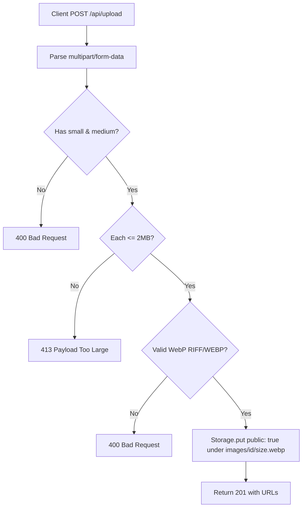

# Handoff: PR-19 / T-032
## Builder notes
### What changed
- **Upload API (`src/app/api/upload/route.ts`):**
  - Handles `POST /api/upload` multipart requests with `small`, `medium`, and optional `large` form entries.
  - Validates WebP magic bytes: `RIFF` at offset 0-3 and `WEBP` at offset 8-11. Rejects invalid magic bytes with 400.
  - Validates size limit <= 2 MB (2 * 1024 * 1024 bytes) per entry, returning 413 if exceeded.
  - Generates an image ID via `nanoid()`.
  - Persists images using the `Storage` adapter under `images/<nanoid>/<size>.webp` with `public: true`.
  - Returns `{ urls: { small, medium, large? } }` with HTTP status 201.
- **Dependency Pinning (`package.json`):**
  - Pinned `@aws-sdk/client-s3` to `"3.1149.0"` (removed `^`) in `dependencies`.
- **Test Suites:**
  - `src/app/api/upload/route.test.ts`: 6 tests testing full upload flow, missing small/medium fields, invalid WebP magic bytes, optional large handling, and 413 on files over 2 MB.
  - Adjusted storage cleanup hooks in `src/app/api/galleries/route.test.ts` and `src/lib/storage/storage.test.ts` to execute on `afterAll` rather than `afterEach` to avoid race conditions with concurrent Vitest test workers.

### Diagram


### How to test
```bash
git fetch origin && git switch feat/T-032-upload-api && npm ci
npm run lint && npm run typecheck && npm run format:check && npm test
npm run build
```

## Review rounds
<!-- Reviewer appends verdict below -->
