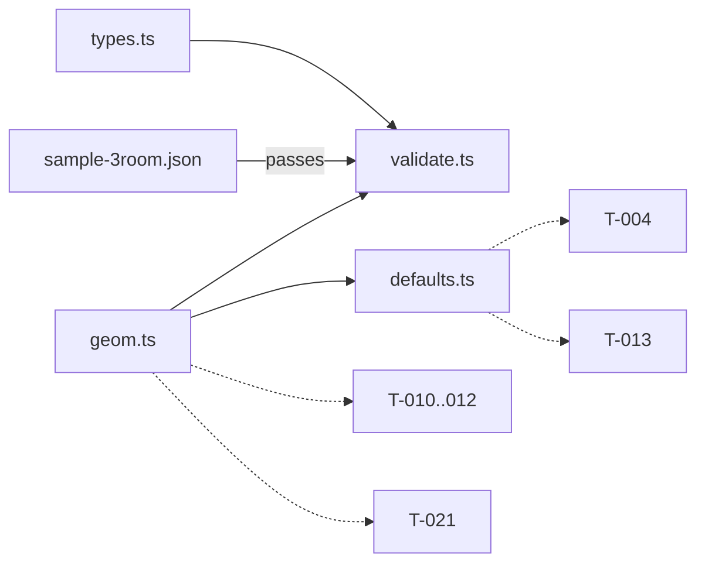

# Handoff: PR-2 / T-003
## Builder notes
### What changed
The Gallery schema is frozen in code under `src/lib/schema/`:
- **`types.ts`:** plan.md §6 verbatim.
- **`geom.ts`:** the single comparison helper. It works in whole half-meter grid units; touching rooms don't overlap.
- **`validate.ts`:** zod plus cross checks. It returns `{ ok, gallery?, issues[] }`, never throws, and has a compile-time guard that keeps the schema and the types identical.
- **`defaults.ts`:** `newRoom`, `newGallery` and `LIGHTING_PRESETS` (plain data).
- **Fixture:** `src/fixtures/sample-3room.json` (L shape) with `public/fixtures/placeholder.webp` (512 × 384).

**Who uses what:**
- **Compile (T-010–T-012):** `sameLine` and `rangeOverlap` to find shared edges. A doorway is cut only if the overlap is ≥ 1.0 m (ADR-007). That threshold lives in compile, not geom.
- **Editor (T-021, builder-2):** `rectsOverlap` before `addRoom` / `updateRoom`; `snap` / `snapRect` for drag.
- **Store (T-004):** `newRoom`, `newGallery`, `snapRect`, and the fixture as initial state.
- **Renderer (T-013):** `LIGHTING_PRESETS[room.lighting]`.

**Beyond the card's reject list (flagged in the PR):** duplicate ids, overlapping rooms, and at least 1 room. Not included: `wallHeight ≥ 2.6` (G4) and artwork fit (G10).

### Diagram

Fixture (top view):
```
0      4  6           12
+------+--+-----------+ 0
|  Entrance |  East Hall |   full shared wall x=6, y 0..6
+------+--+-----------+ 6
| South|                     partial shared wall y=6, x 0..4 (4 m)
| Room |
+------+ 11
```
### How to test
```bash
git fetch origin && git switch feat/T-003-schema && npm ci
npm run lint && npm run typecheck && npm test     # 45 tests
```
- **Drift guard:** add `| "tile"` to `Room.floor` in types.ts and run `npm run typecheck`. It should fail at validate.ts (the schema guard). Revert.
- **Spot check validate:** in a vitest file, `validate(null)` and `validate({})` return `ok: false` with issues and don't throw.
- **Placeholder image:** with `npm run dev` running, http://localhost:3000/fixtures/placeholder.webp should serve the image.

## Review rounds
### Round 1
**Verdict** / **Blocking issues** / **Non-blocking suggestions** / **What I tested**
## DevOps notes
CI result / merge commit / release note
