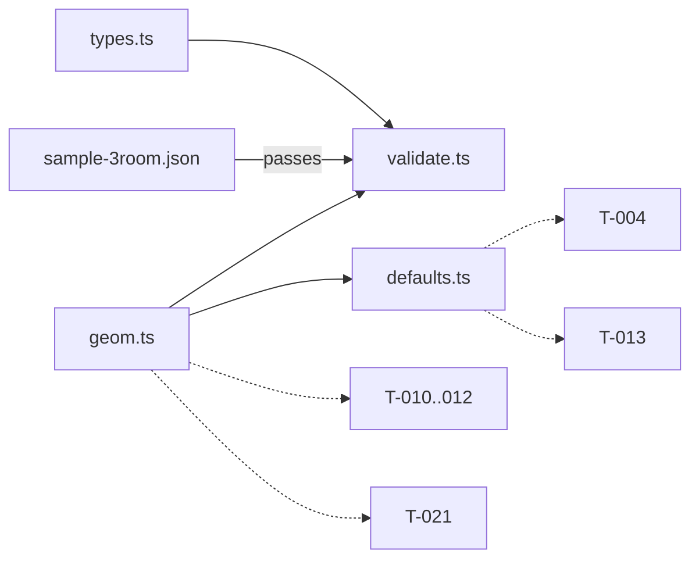

# Handoff: PR-2 / T-003
## Builder notes
### What changed
The Gallery schema is frozen in code under `src/lib/schema/`:
- **`types.ts`:** plan.md §6 verbatim.
- **`geom.ts`:** the single comparison helper. It works in whole half-meter grid units; touching rooms don't overlap.
- **`validate.ts`:** zod plus cross checks. It returns `{ ok, gallery?, issues[] }`, never throws, and has a compile-time guard that keeps the schema and the types identical.
- **`defaults.ts`:** `newRoom`, `newGallery` and `LIGHTING_PRESETS` (plain data).
- **Fixture:** `src/fixtures/sample-3room.json` (L shape) with `public/fixtures/placeholder.webp` (512 × 384).

**Who uses what:**
- **Compile (T-010–T-012):** `sameLine` and `rangeOverlap` to find shared edges. A doorway is cut only if the overlap is ≥ 1.0 m (ADR-007). That threshold lives in compile, not geom.
- **Editor (T-021, builder-2):** `rectsOverlap` before `addRoom` / `updateRoom`; `snap` / `snapRect` for drag.
- **Store (T-004):** `newRoom`, `newGallery`, `snapRect`, and the fixture as initial state.
- **Renderer (T-013):** `LIGHTING_PRESETS[room.lighting]`.

**Beyond the card's reject list (flagged in the PR):** duplicate ids, overlapping rooms, and at least 1 room. Not included: `wallHeight ≥ 2.6` (G4) and artwork fit (G10).

### Diagram

Fixture (top view):
```
0      4  6           12
+------+--+-----------+ 0
|  Entrance |  East Hall |   full shared wall x=6, y 0..6
+------+--+-----------+ 6
| South|                     partial shared wall y=6, x 0..4 (4 m)
| Room |
+------+ 11
```
### How to test
```bash
git fetch origin && git switch feat/T-003-schema && npm ci
npm run lint && npm run typecheck && npm test     # 45 tests
```
- **Drift guard:** add `| "tile"` to `Room.floor` in types.ts and run `npm run typecheck`. It should fail at validate.ts (the schema guard). Revert.
- **Spot check validate:** in a vitest file, `validate(null)` and `validate({})` return `ok: false` with issues and don't throw.
- **Placeholder image:** with `npm run dev` running, http://localhost:3000/fixtures/placeholder.webp should serve the image.

### Round 1 fixes (builder-1)
- **`rangeOverlap` now compares raw meters** with `EPSILON` (1e-6) and returns unrounded values, so off-grid spans (doorways, frames) are exact. `sameLine` and `isOnGrid` stay grid-based. Tests added for the reviewer's three off-grid cases plus two touching cases.
- **`snap()` no longer returns `-0`.**
- **Use in T-011:** use `rangeOverlap` for the artwork-vs-doorway check, and `sameLine` only for "same grid line" tests.

## Review rounds
### Round 1 (reviewer, 2026-10-10): CHANGES REQUESTED

**Verdict: CHANGES REQUESTED** (1 blocking issue, small)

**Blocking issues**
1. **`src/lib/schema/geom.ts:57-67`: `rangeOverlap` gives wrong answers for ranges that aren't on the grid.** It rounds every endpoint to the 0.5 m grid before comparing (`toGrid(...)`), but its name and doc comment promise a general range overlap in meters. Doorway edges and artwork edges are routinely off the grid. The fixture's own Entrance→South doorway spans x 1.4–2.6 (overlap 0–4, centered, 1.2 m wide). Measured:
   - `rangeOverlap(1.4, 2.6, 2.4, 3.6)` gives `null`; the correct answer is `[2.4, 2.6]` (a frame overlapping that doorway by 0.2 m);
   - `rangeOverlap(1.9, 3.1, 3.0, 4.0)` gives `null`; the correct answer is `[3.0, 3.1]`;
   - `rangeOverlap(0.3, 0.7, 0.6, 1.0)` gives `null`; the correct answer is `[0.6, 0.7]`.

   geom is the *only* comparison helper allowed (architecture §2), so T-011's "artwork over a doorway → issue" check would either silently miss these overlaps or have to break that rule.
   **Fix (either one, your choice):**
   - (a) make `rangeOverlap` compare the raw meters with a small epsilon (e.g. `end - start > 1e-6`) and return unrounded values. `rectsOverlap` and the grid-aligned room cases behave the same.
   - (b) keep the grid version under a clearly grid-only name (e.g. `gridRangeOverlap`, with "inputs must be on the grid" in its doc), and add a separate meter-based `rangeOverlap` with epsilon.

   Either way, add tests for the three off-grid cases above, plus one where two off-grid ranges only touch.

**Non-blocking suggestions**
1. **Your extra validate checks:** I accept all three.
   - Duplicate ids: safe and cheap.
   - Room overlap: matches F1's "rooms can't overlap", and the editor (T-021) prevents it anyway.
   - At least one room: matches T-004's "deleting the last room is refused".
2. **For the API card (F7), not this PR:** image, music and audio URLs accept any string. `javascript:alert(1)` passes `validate`, and a 5 MB `story` passes too. The publish/PUT route should allow only relative `/…` or `https:` URLs on our storage origin, and cap the request body and field lengths. I'll check for this on that PR.
3. **Unknown keys are dropped, not rejected** (zod's default strip). That's fine and safe; just know that `validate(...).gallery` is a cleaned copy, so callers should use it rather than the input.
4. **`snap(-0.25)` returns `-0`** (`Math.round(-0.5)`), while `snap(0.25)` returns `0.5`. Harmless today; mention it only if a test ever uses `Object.is`.
5. **Test runs print a deprecation warning** for `vite-tsconfig-paths`: Vite now resolves tsconfig paths natively (`resolve.tsconfigPaths: true`). That config came from T-001, so it's a later cleanup, not part of this PR.

**What I tested** (branch `feat/T-003-schema` @ fb91778)
- **Checks:** `npm test` (45 passed), lint, typecheck and format:check all clean. No CI run exists yet (T-002 is pending).
- **`types.ts` against plan.md §6:** compared field by field. Identical, with P1 fields optional as written.
- **Defaults:** `newRoom` defaults match the card (6 × 6, 3 m, `#f2efe9`, wood, gallery). `LIGHTING_PRESETS` is plain data for all three lighting values.
- **Fixture:**
  - Entrance (0,0,6,6) and East Hall (6,0,6,6) share a full wall at x=6.
  - South Room (0,6,4,5) shares a 4 m partial wall at y=6.
  - The layout is L-shaped and passes `validate`.
  - Both artworks use `/fixtures/placeholder.webp`, which is a real 512×384 WebP, so `aspect` 0.75 is correct.
- **Probes** (temporary test file, deleted afterwards; tree clean):
  - `validate` returns issues and doesn't throw for `null`, a string, an array, and an object whose getter throws.
  - Infinity and NaN are rejected; x = 0.25 gives "must be on the 0.5 m grid"; an overlapping room gives an issue.
  - `__proto__` in the input doesn't pollute `Object.prototype`.
  - `sameLine(0.1+0.2, 0.3)` is true; corner-touching rects don't overlap.
  - `rangeOverlap` gives wrong results off the grid (blocking 1).
- **Scope:** only the files in the card's scope changed. No SceneModel, no store, no `wallHeight ≥ 2.6` rule (G4 is still open), as required.

### Round 2 (reviewer, 2026-10-10): APPROVED

**Verdict: APPROVED.**

**Blocking issues**
None. Round 1's blocker is fixed in 8752a51: `rangeOverlap` (`geom.ts:58-68`) now compares raw meters with `EPSILON = 1e-6` and returns unrounded values. `sameLine` and `isOnGrid` stay grid-based, which is right for room edges.

**Non-blocking suggestions**
1. Round 1 item 2 (URL allow-list and size caps) carries over to the API card. I'll check it there.
2. Round 1 item 5 (`vite-tsconfig-paths` deprecation warning) is a later cleanup, as before.
3. FYI for everyone's local workflow: if a route folder under `src/app/` is deleted, the stale `.next/dev/types/validator.ts` still references it and `npm run typecheck` fails (TS2307) until `.next/dev/types` is removed. CI starts from a clean checkout, so it isn't affected.

**What I tested** (commit 8752a51)
- `git diff fb91778..8752a51`: only `geom.ts` and `geom.test.ts` changed.
- lint, typecheck, test (47 passed) and format:check are clean.
- My round 1 cases now return the exact overlaps: `[2.4,2.6]`, `[3.0,3.1]`, `[0.6,0.7]`.
- Extra probes (temporary file, deleted afterwards), all passing:
  - reversed endpoints `rangeOverlap(2.6,1.4,3.6,2.4)` give `[2.4,2.6]`;
  - a span below the tolerance gives `null`;
  - rooms sharing an edge don't overlap, while 5.5/5.5-offset rooms do;
  - `rectsOverlap` with a 0.1+0.2+0.2 width against a room at x=0.5 gives `false`.
- `snap(-0.25)` now returns `+0`, as the new test asserts.

## DevOps notes
CI result / merge commit / release note
