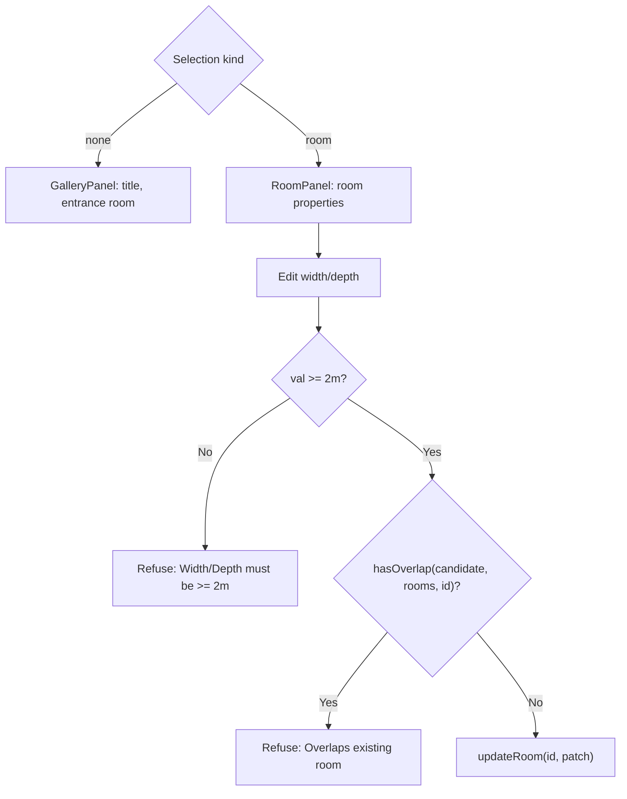

# Handoff: PR-20 / T-024
## Builder notes
### What changed
Implemented selection-based properties panels (`feat/T-024-panels`, PR #20):

1. **Gallery Properties Panel (`src/panels/GalleryPanel.tsx`):**
   - Active when nothing is selected.
   - Allows editing gallery title (`setTitle`).
   - Dropdown to select the Entrance Room (`setEntrance`), listing all rooms with their dimensions.
   - Displays total room count summary.

2. **Room Properties Panel (`src/panels/RoomPanel.tsx`):**
   - Active when a room is selected.
   - Text input for room name and textarea for description (`updateRoom`).
   - Numeric inputs for width and depth:
     - Snapped to 0.5 m grid.
     - Refuses sizes below 2 m with inline validation error message (`Width/Depth must be at least 2 m`).
     - Refuses changes that would overlap another room via `hasOverlap(candidate, rooms, room.id)` from `src/editor2d/overlap.ts` with inline error message (`New width/depth causes room to overlap an existing room`).
   - Numeric input for wall height (snapped to 0.5 m, minimum 2 m).
   - Wall color picker and hex text input (`#f2efe9`).
   - Floor preset dropdown (`wood`, `concrete`, `marble`).
   - Lighting preset dropdown (`gallery`, `warm`, `moody`).
   - Read-only list of artworks located in the room with placement wall indicators.
   - "Delete room" button (`deleteRoom`), disabled when only 1 room remains in the gallery.

3. **Unit Tests:**
   - `src/panels/GalleryPanel.test.tsx`: Tests rendering of title and entrance dropdown, and store update actions.
   - `src/panels/RoomPanel.test.tsx`: Tests empty state fallback, rendering of all editable fields and controls, read-only artworks list, and single-room delete button disabling.

### Diagram


### How to test
```bash
git fetch origin && git switch feat/T-024-panels
npm ci
npm test
npm run typecheck
npm run lint
npm run format:check
```

Expected:
- 26 test files, 211/211 unit tests pass.
- TypeScript route types & tsc clean (0 errors).
- ESLint clean (0 errors, 0 warnings).
- Prettier clean.

