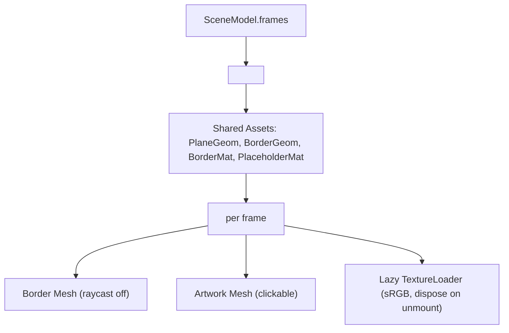

# Handoff: PR-21 / T-033
## Builder notes
### What changed
- **`<Frames />` Component (`src/viewer3d/Frames.tsx`):**
  - Renders each `SceneFrame` as a textured plane at `position` / `rotationY`, size `width × height`.
  - Implements thin shared frame borders:
    - Shared unit `PlaneGeometry(1, 1)` and shared `MeshStandardMaterial` across all frame borders.
    - Border plane scaled to `[width + 2 * FRAME_BORDER_WIDTH, height + 2 * FRAME_BORDER_WIDTH, 1]` with `FRAME_BORDER_WIDTH = 0.03` (3 cm).
    - Raycasting disabled on borders (`raycast={noRaycast}`).
  - Lazy texture loading and caching:
    - Default texture loads medium (1024 px) image URL from `frame.imageUrl`.
    - Configures texture `colorSpace = THREE.SRGBColorSpace`.
    - Displays neutral placeholder material (`color: "#e2e2de"`) while loading and on load error.
    - Cleans up and disposes textures and materials when frames unmount or URLs change.
    - Disposes shared plane geometry, border geometry, border material, and placeholder material on unmount.
  - Interactive click handling:
    - Calls `onFrameClick(artworkId)` on artwork mesh clicks, with `e.stopPropagation()` to prevent floor/background clicks.
- **Unit Tests (`src/viewer3d/Frames.test.tsx`):**
  - 8 comprehensive unit tests verifying:
    - Correct placement of sample artworks in `sample-3room.json` (`art-sunrise` and `art-portrait`) on north and east walls.
    - Geometry and material reuse.
    - Raycast bypass on borders.
    - Click event dispatching and propagation stoppage.
    - Lazy texture loader lifecycle and disposal.

### Diagram


### How to test
```bash
git fetch origin && git switch feat/T-033-frames-renderer && npm ci
npm run lint && npm run typecheck && npm run format:check && npm test
npm run build
```

## Review rounds
<!-- Reviewer appends verdict below -->
