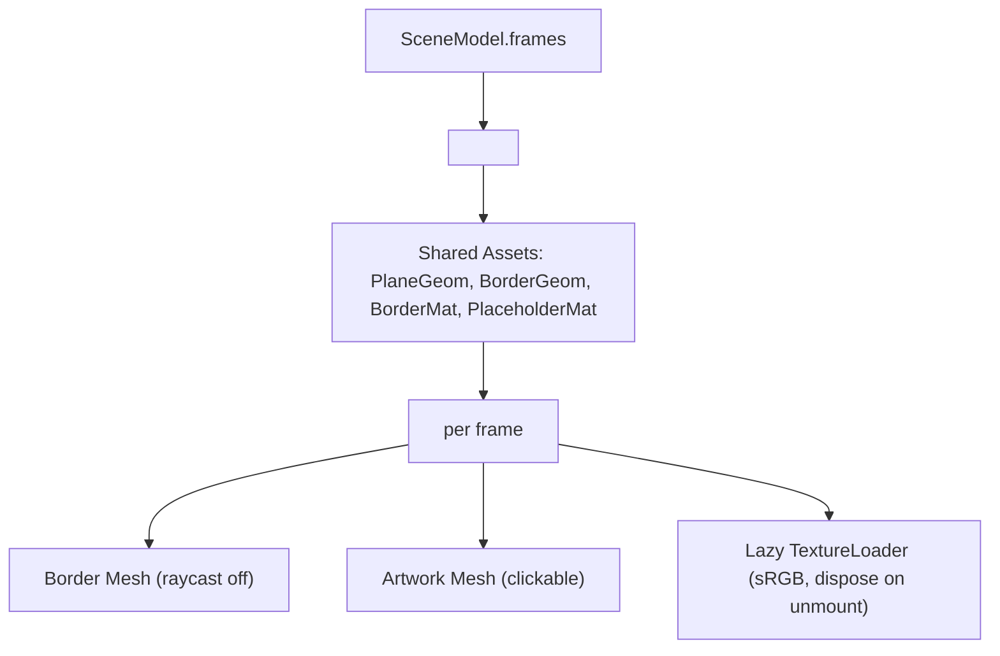

# Handoff: PR-21 / T-033
## Builder notes
### What changed
- **`<Frames />` Component (`src/viewer3d/Frames.tsx`):**
  - Renders each `SceneFrame` as a textured plane at `position` / `rotationY`, size `width × height`.
  - Implements thin shared frame borders:
    - Shared unit `PlaneGeometry(1, 1)` and shared `MeshStandardMaterial` across all frame borders.
    - Border plane scaled to `[width + 2 * FRAME_BORDER_WIDTH, height + 2 * FRAME_BORDER_WIDTH, 1]` with `FRAME_BORDER_WIDTH = 0.03` (3 cm).
    - Raycasting disabled on borders (`raycast={noRaycast}`).
  - Lazy texture loading and caching:
    - Default texture loads medium (1024 px) image URL from `frame.imageUrl`.
    - Configures texture `colorSpace = THREE.SRGBColorSpace`.
    - Displays neutral placeholder material (`color: "#e2e2de"`) while loading and on load error.
    - Cleans up and disposes textures and materials when frames unmount or URLs change.
    - Disposes shared plane geometry, border geometry, border material, and placeholder material on unmount.
  - Interactive click handling:
    - Calls `onFrameClick(artworkId)` on artwork mesh clicks, with `e.stopPropagation()` to prevent floor/background clicks.
- **Unit Tests (`src/viewer3d/Frames.test.tsx`):**
  - 8 comprehensive unit tests verifying:
    - Correct placement of sample artworks in `sample-3room.json` (`art-sunrise` and `art-portrait`) on north and east walls.
    - Geometry and material reuse.
    - Raycast bypass on borders.
    - Click event dispatching and propagation stoppage.
    - Lazy texture loader lifecycle and disposal.

### Diagram


### How to test
```bash
git fetch origin && git switch feat/T-033-frames-renderer && npm ci
npm run lint && npm run typecheck && npm run format:check && npm test
npm run build
```

## Review rounds
### Round 1 (reviewer-2, 2026-10-10): APPROVED

**Verdict: APPROVED**

**Blocking issues**
None.

**Non-blocking suggestions**
- None. Clean implementation with proper texture and geometry disposal, sRGB color space configuration, and shared asset reuse.

**What I tested**
- Automated test suite (`npm test`): 25/25 test suites pass, 213/213 tests pass (including all 8 Frames component tests in `src/viewer3d/Frames.test.tsx`).
- Route types and static type analysis (`npm run typecheck`): Clean, 0 errors.
- ESLint (`npm run lint`): Clean, 0 errors.
- Prettier check (`npm run format:check`): Clean.
- Next.js production build (`npm run build`): Compiled successfully with Turbopack and Cache Components.
- GitHub CI checks on PR #21: 4/4 checks passed (Vercel deployment, Vercel Preview Comments, CI/ci, docs-guard).
- Verified rendering criteria:
  - Each frame drawn as a textured plane at `position` / `rotationY`, size `width × height`.
  - Shared border plane scaled to `[width + 2 * FRAME_BORDER_WIDTH, height + 2 * FRAME_BORDER_WIDTH, 1]` with `FRAME_BORDER_WIDTH = 0.03`.
  - Border raycasting disabled via `raycast={noRaycast}`.
  - Lazy texture loading with `THREE.TextureLoader`, `colorSpace = THREE.SRGBColorSpace`, and neutral placeholder while loading or on error.
  - Proper disposal of textures, materials, and shared geometries on unmount / URL change.
  - Interactive click handling (`onFrameClick(artworkId)`) with `stopPropagation()`.


## DevOps notes
**Merged** 2026-10-10T11:27:13Z, squash commit `54870d9` on `main`, branch deleted. Merge gate: card `approved`, `review-approved` (reviewer-2), `ci` + `docs-guard` green. Scope matches the card (`src/viewer3d/Frames.{tsx,test.tsx}`), nothing stacked.
