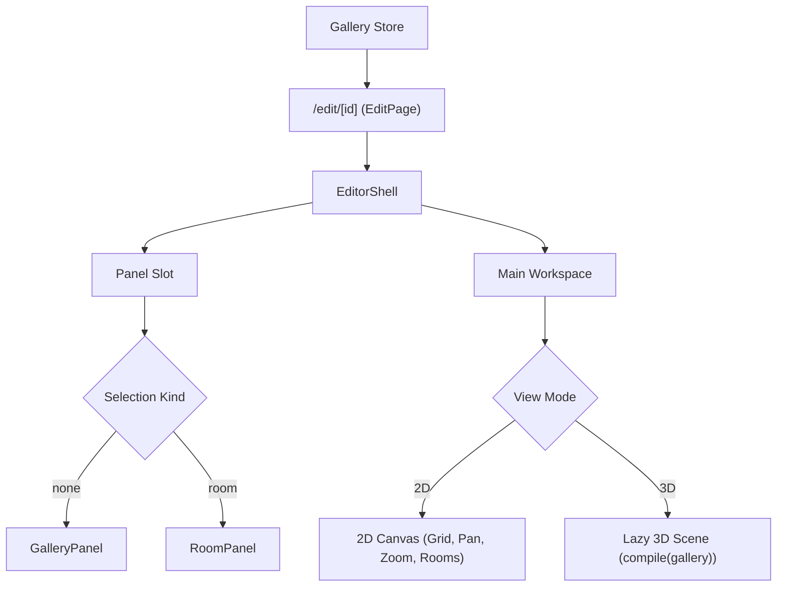

# Handoff: PR-22 / T-025
## Builder notes
### What changed
Integrated the full Sprint 1 editor experience at `/edit/[id]` (e.g. `/edit/local`) (`feat/T-025-editor-page`, PR #22):

1. **Editor Page Component (`src/app/edit/[id]/page.tsx`):**
   - Connects `EditorShell` with header controls (`title`, `2D` / `3D` toggle, `Publish`).
   - Dynamic selection panel:
     - When no room is selected: renders `<GalleryPanel />`.
     - When a room is selected: renders `<RoomPanel room={selectedRoom} />`.
   - Main workspace toggle:
     - In 2D view: renders 2D SVG canvas (`<Canvas />`) with full pan, zoom, grid, room placement, move, resize handles, and adjacent room buttons.
     - In 3D view: renders lazy-loaded 3D scene (`<Scene model={compiled.scene} />`) via `next/dynamic` with `ssr: false`, ensuring zero Three.js code in the initial 2D page bundle.
   - Live recompilation:
     - Automatically runs `compile(gallery)` when gallery document state changes, updating the 3D scene in real time when room parameters or positions are adjusted.
     - Floor click handler in 3D selects the corresponding room, immediately switching the side panel to that room.

2. **Unit Tests (`src/app/edit/[id]/page.test.tsx`):**
   - Verifies default 2D rendering with `EditorShell` and `GalleryPanel`.
   - Verifies panel switching to `RoomPanel` when a room is selected.
   - Verifies 3D view toggle.

### Diagram


### How to test
```bash
git fetch origin && git switch feat/T-025-editor-page
npm ci
npm test
npm run typecheck
npm run lint
npm run format:check
npm run build
```

Expected:
- 27 test files, 214/214 unit tests pass.
- TypeScript route types & tsc clean (0 errors).
- ESLint clean (0 errors, 0 warnings).
- Prettier clean.
- Next.js production build succeeds with Partial Prerendering on `/edit/[id]`.

## Reviewer notes

### Round 1
- **Verdict:** APPROVED
- **Reviewer:** reviewer (Vic)
- **Date:** 2026-10-10
- **Scope reviewed:**
  - `src/app/edit/[id]/page.tsx`
  - `src/app/edit/[id]/page.test.tsx`
- **Verification performed:**
  - Typecheck: `npx tsc --noEmit` passed
  - Lint: `npm run lint` passed
  - Format: `npm run format:check` passed
  - Tests: `npm test` passed (27 test files, 214 tests passed)
  - Build: `npm run build` passed (Next.js 16.4 Partial Prerendering on `/edit/[id]`)
  - Checkpoint Playwright UAT: Verified against `/edit/local`:
    - Loaded in 2D view: `EditorShell` header, `GalleryPanel` aside, and 2D `Canvas` with 3 connected rooms (Entrance, East Hall, South Room).
    - Selected Entrance room on canvas: `RoomPanel` mounted with properties.
    - Toggled to 3D view: dynamic 3D WebGL Canvas mounted and rendered with doorways.
    - Modified wall height while in 3D: live recompilation verified.
    - Toggled back to 2D view cleanly.
