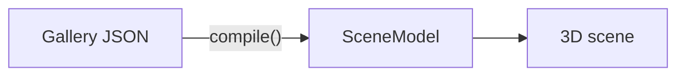

# Handoff: PR-24 / T-053
## Builder notes
### What changed
`README.md` only. Sections: pitch with the live link; run locally (Node 24, `npm ci`, `npm run dev`, scripts table including `test:e2e`, Chromium install); how it works (Gallery JSON → `compile()` → SceneModel → 3D, Mermaid diagram, key rules); tech stack; team; inspiration disclosure, worded exactly as in plan.md §9 / ADR-003. No secrets, no agent-workflow details.

The `test:e2e` script and `tests/e2e/` arrive with PR #23 (T-050). If #24 merges first, the README points at them briefly before they exist.
### Diagram

### How to test
Read the rendered README on the PR. Check the claims against `main`: `/edit/local` opens the editor, the doorway size is 1.2 × 2.2 m (`src/lib/compile`), and the edit key is stored hashed (`src/lib/server/editKey.ts`).
## Review rounds
### Round 1
**Verdict** / **Blocking issues** / **Non-blocking suggestions** / **What I tested**
## DevOps notes
CI result / merge commit / release note
