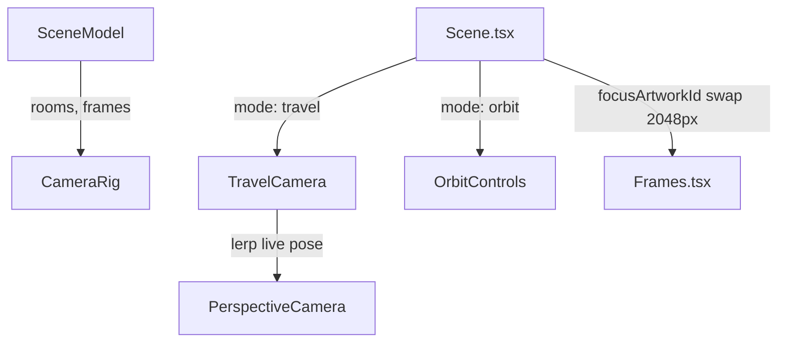

# Handoff: PR-25 / T-034

## Builder notes
### What changed
- Added `src/viewer3d/CameraRig.tsx` implementing `CameraRig`:
  - Switches between `"orbit"` (`<OrbitControls>`) and `"travel"` (`<TravelCamera>`) modes (plan.md §5.4, ADR-002, R4, R5, R6).
  - Target poses derive strictly from `SceneModel`: `room.view` for rooms; ~1.8 m in front of artwork along normal at center height looking at frame center.
  - Transitions ease position, target, and FOV over ~1.0 s via `easeInOutCubic`, interpolating from the live camera pose so mid-flight interruptions never jump.
  - Clamped frame delta (`MAX_FRAME_DELTA = 1 / 15` s per R6).
  - On-demand rendering: requests redraws (`state.invalidate()`) only while moving.
  - Moving state notification deduplication prevents redundant notifications (R11).
- Updated `src/viewer3d/Scene.tsx`:
  - Added `mode`, `currentRoomId`, `focusArtworkId?`, `onFrameClick?`, `onMovingChange?`, and `largeImages?` props while keeping `onFloorClick`, `model`, `className` fully backward compatible for T-025.
  - Wires `<Frames>` inside its own Suspense boundary (R2).
  - Swaps focused artwork image to 2048 px image if present (plan.md §7).
  - Replaces `<OrbitCamera>` with `<CameraRig>`.
- Added `src/viewer3d/CameraRig.test.ts`:
  - 14 unit tests covering constants, curves, boundary clamping, all 4 wall orientations, custom distances/FOVs, integration with compile/sample-3room, and 2048 px focus image swap logic.

### Diagram


### How to test
```bash
npm run format:check
npm run typecheck
npm run lint
npm test
npm run build
```

## Review rounds
### Round 1
**Verdict** / **Blocking issues** / **Non-blocking suggestions** / **What I tested**

## DevOps notes
CI result / merge commit / release note
