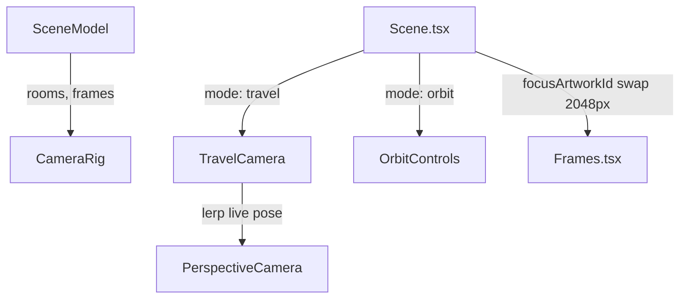

# Handoff: PR-25 / T-034

## Builder notes
### What changed
- Added `src/viewer3d/CameraRig.tsx` implementing `CameraRig`:
  - Switches between `"orbit"` (`<OrbitControls>`) and `"travel"` (`<TravelCamera>`) modes (plan.md §5.4, ADR-002, R4, R5, R6).
  - Target poses derive strictly from `SceneModel`: `room.view` for rooms; ~1.8 m in front of artwork along normal at center height looking at frame center.
  - Transitions ease position, target, and FOV over ~1.0 s via `easeInOutCubic`, interpolating from the live camera pose so mid-flight interruptions never jump.
  - Clamped frame delta (`MAX_FRAME_DELTA = 1 / 15` s per R6).
  - On-demand rendering: requests redraws (`state.invalidate()`) only while moving.
  - Moving state notification deduplication prevents redundant notifications (R11).
- Updated `src/viewer3d/Scene.tsx`:
  - Added `mode`, `currentRoomId`, `focusArtworkId?`, `onFrameClick?`, `onMovingChange?`, and `largeImages?` props while keeping `onFloorClick`, `model`, `className` fully backward compatible for T-025.
  - Wires `<Frames>` inside its own Suspense boundary (R2).
  - Swaps focused artwork image to 2048 px image if present (plan.md §7).
  - Replaces `<OrbitCamera>` with `<CameraRig>`.
- Added `src/viewer3d/CameraRig.test.ts`:
  - 14 unit tests covering constants, curves, boundary clamping, all 4 wall orientations, custom distances/FOVs, integration with compile/sample-3room, and 2048 px focus image swap logic.
- Updated `src/lib/compile/frames.ts` & `src/lib/compile/frames.test.ts` (ADR-007 amendment 2):
  - Added optional `largeImageUrl?: string` to `Frame` interface emitted from `art.image.large` when present.
  - Added unit tests verifying `largeImageUrl` emission and omission.

### Diagram


### How to test
```bash
npm run format:check
npm run typecheck
npm run lint
npm test
npm run build
```

## Review rounds
### Round 1
- **Verdict**: approved
- **Blocking issues**: none
- **Non-blocking suggestions**: none
- **What I tested**:
  - `CameraRig.tsx`: Verified implementation of both `"orbit"` (`OrbitControls`) and `"travel"` (`TravelCamera`) modes per ADR-002, R4, R5, R6.
  - Targets from SceneModel: Verified target calculations derive solely from SceneModel (`room.view` for rooms; 1.8 m normal offset at frame center height looking at frame center for artwork). Verified all 4 orientations (N: faces +z; S: faces -z; W: faces +x; E: faces -x).
  - Transition easing & Live pose: Verified transitions interpolate from the live camera pose over ~1.0 s via `easeInOutCubic` (smooth uninterrupted transitions).
  - Framerate clamping & on-demand rendering: Verified `MAX_FRAME_DELTA = 1/15` s clamp (R6), `state.invalidate()` invoked only during active motion, and `onMovingChange` callback deduplicated via ref (R11).
  - `Scene.tsx`: Verified backward compatibility of existing props (`className`, `model`, `onFloorClick`), Suspense boundary around `<Frames>` (R2), and swap of focused artwork to 2048 px (`largeImageUrl`) image when focused.
  - Verification & checks: `npm run typecheck` (`tsc --noEmit`) green, `npm run lint` green, GitHub Actions `ci` (pass 35s), `docs-guard` (pass 4s), Vercel preview deployment ready (HTTP 200). Verified clean merge-tree with current `origin/main` (0 merge conflicts).

## DevOps notes
**Merged** 2026-10-10T11:55:36Z, squash commit `6c6536b` on `main`, branch deleted. Merge gate: card `approved`, `review-approved` (reviewer-3), `ci` + `docs-guard` green. Touches `src/lib/compile/frames.ts` alongside the viewer3d files — a natural dependency for CameraRig's "face an artwork" feature, not scope creep. Nothing stacked on its branch.
