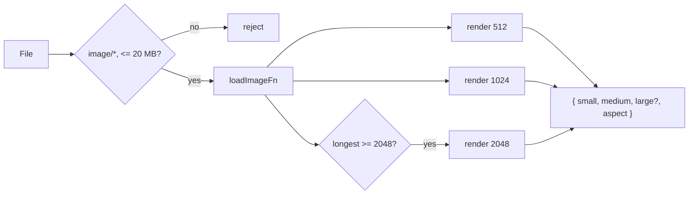

# Handoff: PR-26 / T-040
## Builder notes
### What changed
`src/upload/resizeImage.ts` (+ test) on `feat/T-040-resize-image`:
- `fitWithin(w, h, max)`: pure size math, longest side ≤ max, never upscales, throws on non-positive input.
- `resizeImage(file)` → `{ small ≤512, medium ≤1024, large? ≤2048, aspect = h/w }`. `large` is omitted when the original's longest side is under 2048 px. Rejects non-`image/*` types and files over 20 MB.
- Canvas/WebP is behind injectable `loadImageFn` / `renderWebPFn` (defaults: `createImageBitmap` with `Image` fallback, canvas `toBlob("image/webp", 0.85)`), so tests fake it.

### Diagram


### How to test
```bash
git fetch origin && git switch feat/T-040-resize-image
npm ci && npm test && npm run typecheck && npm run lint && npm run format:check
```
Expected: 29 files, 234/234 pass; the rest clean.

### Notes / limits
- The real canvas/WebP path is not exercised by unit tests (node env); it gets its first real run with T-041's upload button.
- Safari older than 14 cannot encode WebP via canvas (it returns PNG); acceptable for the hackathon, and `/api/upload` rejects non-WebP.

## Reviewer notes

### Round 1
- **Verdict:** APPROVED
- **Reviewer:** reviewer (Vic)
- **Date:** 2026-10-10
- **Scope reviewed:**
  - `src/upload/resizeImage.ts`
  - `src/upload/resizeImage.test.ts`
- **Verification performed:**
  - Typecheck: `npx tsc --noEmit` passed
  - Lint: `npm run lint` passed
  - Format: `npm run format:check` passed
  - Tests: `npm test` passed (29 test files, 234 tests passed)
  - Build: `npm run build` passed
  - Acceptance criteria verified:
    - `fitWithin` pure size math, never upscales, preserves aspect ratio
    - `resizeImage` creates WebP blobs for small (<=512 px) and medium (<=1024 px); large (<=2048 px) included only when longest >= 2048 px
    - `aspect` equals height / width of original
    - Rejects non-image types and files exceeding 20 MB with clear error messages
    - Injectable decoding and rendering functions allow robust test execution

