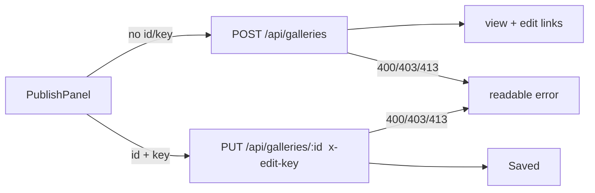

# Handoff: PR-27 / T-044
## Builder notes
### What changed
`feat/T-044-publish-panel`: `src/components/publishClient.ts` (`publishGallery`, `saveGallery`), `PublishPanel.tsx`, and one test file covering both (faked `fetch`).
- Publish: POST `/api/galleries` → `{ id, editKey, viewUrl, editUrl }`; panel shows both links with Copy buttons and a warning that the edit link is secret.
- Later saves: PUT `/api/galleries/:id` with the key only in `x-edit-key`.
- Errors: 400 → joined `path: message` issues, 403 → "Wrong or missing edit key", 413 → "too large", else status code.

### Diagram


### How to test
```bash
git fetch origin && git switch feat/T-044-publish-panel
npm ci && npm test && npm run typecheck && npm run lint && npm run format:check
```

### Notes
- Panel interaction (click → fetch → state) is covered by client tests + SSR render only; no DOM test env exists yet. Wiring into the editor is T-046.
- Flaky on main, not from this PR: storage/upload route tests share `.data/` and fail ~1 run in 2 (a different test each time). Sent as an fyi to the senior.
