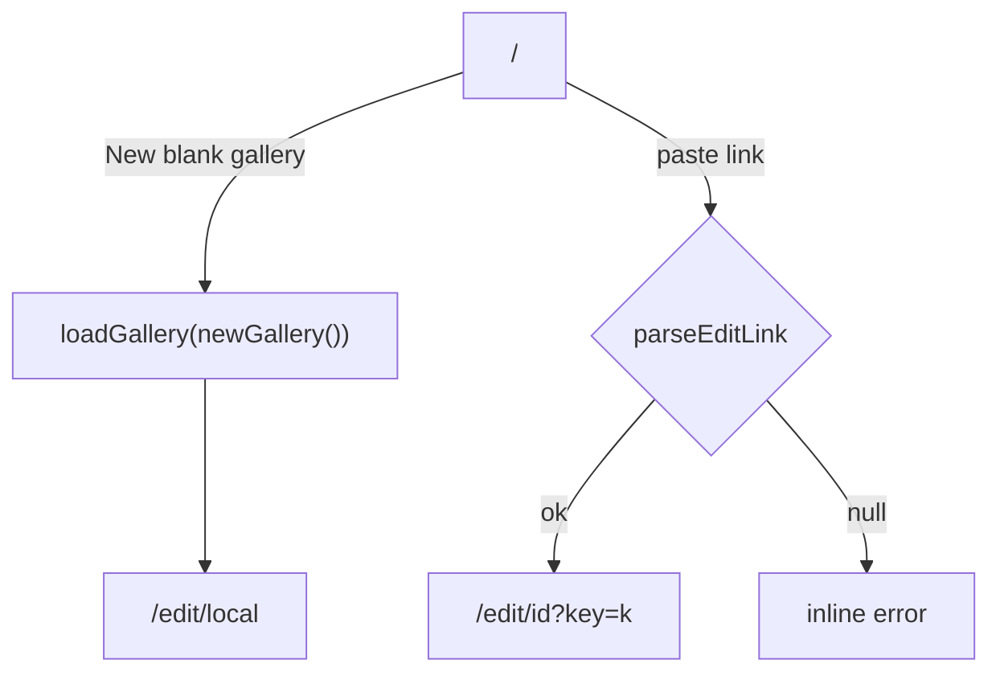

# Handoff: PR-28 / T-045
## Builder notes
### What changed
`feat/T-045-start-screen`: `src/app/page.tsx` (start screen), `src/components/parseEditLink.ts`, `src/app/page.test.tsx`.
- "New blank gallery" → `loadGallery(newGallery())` then `/edit/local`.
- Two template buttons, disabled, labelled "coming soon" (F13 is P1).
- "Open edit link": accepts a full URL or path `…/edit/<id>?key=<k>`; anything else shows an inline `role="alert"` error. Output is always a same-origin path, so a pasted foreign URL can't redirect off-site.
- `parseEditLink` is outside `page.tsx` because Next rejects non-page exports there (one file beyond the card's scope list).

### Diagram


### How to test
```bash
git fetch origin && git switch feat/T-045-start-screen
npm ci && npm test && npm run typecheck && npm run lint && npm run format:check
npm run dev   # http://localhost:3000 : click New blank gallery; paste /edit/abc?key=k
```

### Notes
- Click/submit behaviour is not DOM-tested (no DOM env); parser and markup are. `/edit/<id>` loading by id is T-046, so opening an edit link currently lands on the editor without loading that gallery.
