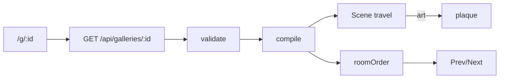

# Handoff: PR-29 / T-035
## Builder notes
### What changed
- **`/g/[id]` viewer** (client):
  - fetches `GET /api/galleries/<id>`, validates, compiles, and renders `<Scene mode="travel">`;
  - friendly 404 page;
  - title bar, Prev/Next room bar using `roomOrder()`;
  - floor click flies to the room; art click focuses it and opens the plaque (Esc/Close).
- **`roomOrder()`:** breadth-first from the entrance, document-order ties, unconnected rooms last. 7 tests.
- **Gotcha:** with Cache Components, `useParams()` must be inside `<Suspense>`; without it the dev overlay shows a blocking-route error.
- **Doorway click (round 1 fix):** `Scene` has an optional `onDoorwayClick(roomIds)` that adds one invisible click box per doorway (R10). The viewer goes to the other room. Scene.tsx scope extension requested from the senior.
- **Flaky test on main:** `storage.test.ts › serves public file with 200` (2/5 runs). I'm fixing it in T-037.
### Diagram

### How to test
```bash
git fetch origin && git switch feat/T-035-viewer-page && npm ci && npm test
npm run dev   # with VULTR_S3_* unset → local .data storage
curl -s -X POST localhost:3000/api/galleries -H 'content-type: application/json' --data @src/fixtures/sample-3room.json
# open the returned viewUrl (/g/<id>)
```
Expect:
- the title and **Entrance**;
- Next → East Hall → South Room → Entrance;
- clicking the artwork straight ahead opens the "Sunrise" plaque, and Esc closes it;
- `/g/nope` shows "This gallery doesn't exist."
## Review rounds
### Round 1
**Verdict** / **Blocking issues** / **Non-blocking suggestions** / **What I tested**
## DevOps notes
CI result / merge commit / release note


**Verdict: Changes requested — T-035, round 1 (b20e1e2).**

**Blocking issue**
- `src/app/g/[id]/page.tsx:135`: navigation wires floor and frame clicks only; `Scene` has no doorway hit target or callback. Clicking a doorway therefore does not fly into its adjacent room, contrary to the third acceptance criterion. Add the doorway interaction (coordinate the Scene scope extension with senior), or obtain an explicit task-card deferral before approval.

**Non-blocking suggestions**
- Reset loading/room/focus state and cancel the entire async response when the dynamic gallery ID changes, so client navigation cannot show stale gallery state.

**What I checked**
- Read the entire four-file diff, task card, handoff, Scene/Floors/CameraRig integration, validation, and installed Next useParams documentation. Suspense usage matches the installed docs; text is rendered through React, and no edit key is requested or rendered.
- CI passed all seven new room-order tests and failed an existing upload-route test at line 76 due to the shared storage race addressed by PR #31. CI must be green before merge.
- Local fixture POST succeeded (201). Independent browser UAT did not complete: the reviewer worktree shares node_modules via a junction; Turbopack rejects it and webpack produces casing conflicts/timeouts. Local Vitest also fails before collecting tests in that setup. These are verification limits, not claimed passes or PR defects.


**Verdict: Approved — T-035, round 2 (222bfbb).**

**Blocking issues:** None remaining. The senior-approved Scene extension adds invisible doorway targets and the viewer now travels to the other connected room.

**What I tested:** Reviewed the follow-up diff and ran exact-revision, in-memory interaction checks: east/west and north/south doorway box dimensions, callback room IDs, propagation stopping, opposite-room travel from both sides, and clearing artwork focus. All passed. CI, Docs guard and Vercel are green. The builder independently reports Chromium doorway UAT (South Room to Entrance). My full browser UAT remains limited by the shared dependency junction/casing issue reported in round 1; I am not claiming an independent browser pass.

**Non-blocking suggestions:** Retain the round-1 gallery-ID state-reset suggestion. DoorwayTargets currently allocates one material per mesh despite its comment saying shared material; sharing can be considered with later renderer optimization.
