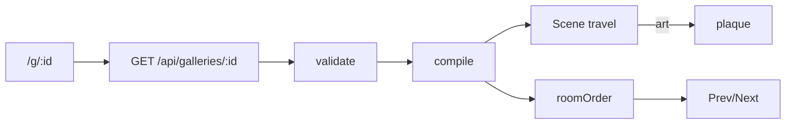

# Handoff: PR-29 / T-035
## Builder notes
### What changed
- **`/g/[id]` viewer** (client):
  - fetches `GET /api/galleries/<id>`, validates, compiles, and renders `<Scene mode="travel">`;
  - friendly 404 page;
  - title bar, Prev/Next room bar using `roomOrder()`;
  - floor click flies to the room; art click focuses it and opens the plaque (Esc/Close).
- **`roomOrder()`:** breadth-first from the entrance, document-order ties, unconnected rooms last. 7 tests.
- **Gotcha:** with Cache Components, `useParams()` must be inside `<Suspense>`; without it the dev overlay shows a blocking-route error.
- **Not done:** doorway click (Scene has no doorway target; Scene.tsx is out of scope). Floor clicks cover travel.
- **Flaky test on main:** `storage.test.ts › serves public file with 200` (2/5 runs). I'm fixing it in T-037.
### Diagram

### How to test
```bash
git fetch origin && git switch feat/T-035-viewer-page && npm ci && npm test
npm run dev   # with VULTR_S3_* unset → local .data storage
curl -s -X POST localhost:3000/api/galleries -H 'content-type: application/json' --data @src/fixtures/sample-3room.json
# open the returned viewUrl (/g/<id>)
```
Expect:
- the title and **Entrance**;
- Next → East Hall → South Room → Entrance;
- clicking the artwork straight ahead opens the "Sunrise" plaque, and Esc closes it;
- `/g/nope` shows "This gallery doesn't exist."
## Review rounds
### Round 1
**Verdict** / **Blocking issues** / **Non-blocking suggestions** / **What I tested**
## DevOps notes
CI result / merge commit / release note
