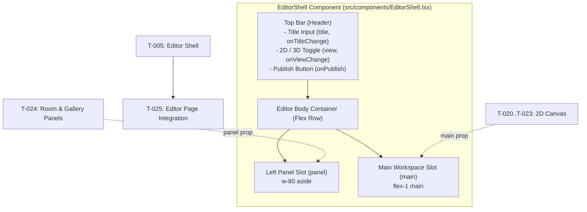

# Handoff: PR-3 / T-005
## Builder notes
### What changed
Added the bare editor layout shell component (`src/components/EditorShell.tsx`) and unit test (`src/components/EditorShell.test.tsx`) on branch `feat/T-005-editor-shell` (PR #3).

- **Structure:**
  - Header / Top bar: Gallery title text input, 2D / 3D segmented toggle, and Publish button.
  - Left panel area (`aside`): Fixed width (320px / `w-80`), scrollable container for properties panels.
  - Main area (`main`): Flexible workspace area for 2D canvas and 3D preview.
- **Props-only interface:**
  - Explicit props: `title`, `onTitleChange`, `view`, `onViewChange`, `onPublish`, `panel`, `main`.
  - Zero store dependencies: builds cleanly and independently without importing the Zustand store.
- **Styling & Responsiveness:**
  - Standard Tailwind CSS utility classes only (light theme baseline matching spec).
  - Usable and flex-responsive at 1024px and 1280px+ wide.
- **Testing:**
  - Vitest unit test asserting rendering of title input, 2D/3D toggle, publish button, panel slot, and main workspace slot.

### Diagram


### How to test
```bash
git fetch origin && git switch feat/T-005-editor-shell
npm ci
npm test
npm run typecheck
npm run lint
npm run format:check
```

Expected:
- Vitest executes `src/components/EditorShell.test.tsx` and `src/lib/smoke.test.ts` with 2/2 tests passing.
- TypeScript (`next typegen && tsc --noEmit`) passes with 0 errors.
- ESLint passes with 0 warnings/errors.
- Prettier formatting passes.

## Review rounds
### Round 1 (reviewer)
Pending review.

## DevOps notes
Pending merge.
