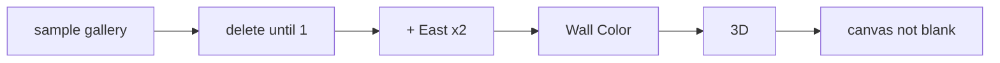

# Handoff: PR-30 / T-050 (follow-up to PR-23)
## Builder notes
### What changed
`tests/e2e/editor.spec.ts`: `test.fixme` changed to `test`, now that T-025 is on `main`. Running it against the real editor showed two wrong assumptions, now fixed:
- `/edit/local` opens on the sample 3-room gallery, and the store keeps at least 1 room. The spec deletes rooms through "Delete room" until 1 is left, then adds 2 with "+".
- The 2D canvas doesn't auto-pan, so "+ North" put the next button off-screen. The spec uses "Add room to the East" twice, which keeps all 3 rooms in the 1280 px viewport.

`tests/e2e/README.md`: the state column now says "enabled".
### Diagram

### How to test
`npm ci && npx playwright install chromium-headless-shell && npm run test:e2e` gives 1 passed. Locally: 1 passed (7.2 s), then 3 passed with `--repeat-each=3`. vitest 268/268.

Possible app follow-up (builder-2, not filed): auto-pan the 2D canvas to keep a newly added room in view.
## Review rounds
### Round 1
**Verdict** / **Blocking issues** / **Non-blocking suggestions** / **What I tested**
## DevOps notes
CI result / merge commit / release note

### Round 1 (reviewer, 2026-10-10): APPROVED
Test-only: the Sprint 1 checkpoint e2e is enabled. It passed 3/3 locally (macOS, --repeat-each=3), and eslint and prettier are clean on tests/e2e. The red ci run 38051242011 is the unrelated flaky shared-.data test in galleries/route.test.ts (T-037), so devops should re-run it. Non-blocking: add a non-required e2e CI job; a builder-2 card for canvas auto-pan to new rooms.
