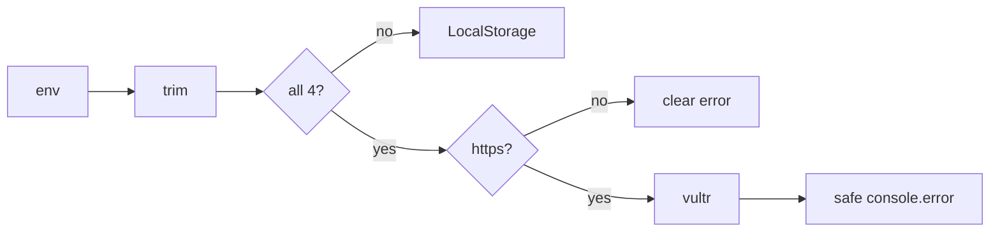

# Handoff: PR-31 / T-037
## Builder notes
### What changed
- **`getStorage()`:**
  - trims all `VULTR_S3_*` values;
  - requires the endpoint to be an `https://` URL, and otherwise throws a message naming `VULTR_S3_ENDPOINT` but never its value;
  - accepts an optional `PEGASUS_DATA_DIR` for the local storage folder (default `.data/`).
- **Vultr failures** log `{ operation, key, name, message, httpStatusCode, code }` via `console.error`, with no credentials or env values. Thrown errors and responses stay generic. A plain not-found isn't logged.
- **Flaky tests fixed:** the storage, upload-route and galleries-route tests use a per-test `mkdtemp` folder via `PEGASUS_DATA_DIR`, so parallel files no longer race on `./.data`. 5/5 green runs locally. This race also failed #29's first CI run.
### Diagram

### How to test
```bash
git fetch origin && git switch feat/T-037-vultr-diagnosable && npm ci
for i in 1 2 3 4 5; do npm test 2>&1 | grep "Tests "; done   # 274 passed every time
ls .data   # tests no longer create it
```
**After merge:** one production upload on https://galliverse.vercel.app/ (or the Vercel log), recorded in handoffs/PR-19.md.
## Review rounds
### Round 1
**Verdict** / **Blocking issues** / **Non-blocking suggestions** / **What I tested**
## DevOps notes
CI result / merge commit / release note
