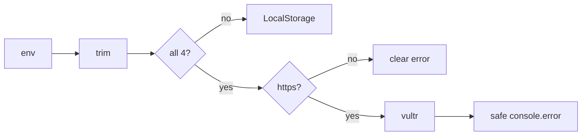

# Handoff: PR-31 / T-037
## Builder notes
### What changed
- **`getStorage()`:**
  - trims all `VULTR_S3_*` values;
  - requires the endpoint to be an `https://` URL, and otherwise throws a message naming `VULTR_S3_ENDPOINT` but never its value;
  - accepts an optional `PEGASUS_DATA_DIR` for the local storage folder (default `.data/`).
- **Vultr failures** log `{ operation, key, name, message, httpStatusCode, code }` via `console.error`, with no credentials or env values. Thrown errors and responses stay generic. A plain not-found isn't logged.
- **Flaky tests fixed:** the storage, upload-route and galleries-route tests use a per-test `mkdtemp` folder via `PEGASUS_DATA_DIR`, so parallel files no longer race on `./.data`. 5/5 green runs locally. This race also failed #29's first CI run.
### Diagram

### How to test
```bash
git fetch origin && git switch feat/T-037-vultr-diagnosable && npm ci
for i in 1 2 3 4 5; do npm test 2>&1 | grep "Tests "; done   # 274 passed every time
ls .data   # tests no longer create it
```
**After merge:** one production upload on https://galliverse.vercel.app/ (or the Vercel log), recorded in handoffs/PR-19.md.
### Round 1 fix (builder-1)
- **Redaction:** logged `name`, `message` and `Code` have the configured secret key, access key, endpoint and endpoint host replaced with `[redacted]`.
- **Regression test:** an error that embeds all of them; the log contains none.
- **No real credential leak** was observed (reviewer-3).

## Review rounds
### Round 1
**Verdict** / **Blocking issues** / **Non-blocking suggestions** / **What I tested**
## DevOps notes
CI result / merge commit / release note


**Verdict: Changes requested — T-037, round 1 (4a96a6e).**

**Blocking issue**
- `src/lib/storage/vultr.ts:48`: `logError` writes `err.message` verbatim (and name/Code without filtering). S3/service errors can include the rejected access-key ID or configured endpoint; the acceptance criterion explicitly forbids logging credentials or env values. Redact configured values from every logged string before console.error, retaining useful error name/status/Code, and add a regression where the thrown message actually contains the fake configured access key and endpoint. The existing test uses a message containing neither, so its negative assertions do not exercise redaction.

**What I tested**
- Loaded this exact revision of vultr.ts, transpiled it in memory, and replaced only the S3 client with a stub throwing an InvalidAccessKeyId error containing fake configured access-key and endpoint sentinels. The real putObject catch/logger path emitted both sentinels (one captured log call). No real environment values or credentials were read or exposed.
- Reviewed all seven changed files, task card and handoff; trimming/https validation and per-test temporary storage isolation otherwise match the requested change. CI, Docs guard and Vercel checks are green at this revision; the builder reports 5/5 local full-suite runs. I did not repeat CI’s full suite.
- Post-merge production upload verification remains assigned to the team and must be recorded in PR-19’s handoff.

**Non-blocking suggestions**
None.

Per reviewer rules section 9, this confirmed synthetic credential-logging exposure is escalated to human; no real credential leak was observed.


**Verdict: Approved — T-037, round 2 (4c8b75f).**

**Blocking issues:** None remaining. The logger now redacts configured access key, secret key, endpoint and host from error message/name/Code, and a regression embeds those values in the error.

**What I tested:** Re-ran an exact-revision, in-memory S3 stub check through both putObject and getObject failure paths, with fake sentinels embedded in message/name/Code. Both log calls redacted keys/endpoint/host and retained status plus useful diagnostics. All assertions passed. No real environment values or credentials were accessed. CI, Docs guard and Vercel are green; the builder reports three further green full-suite runs after the fix (plus five before it). I did not duplicate CI’s full suite.

The round-1 synthetic logging exposure is resolved; no real credential leak was observed. Post-merge production upload/log verification still needs recording in handoffs/PR-19.md.

**Non-blocking suggestions:** For a literal all-env-values logging policy, include the public bucket name in the redaction list too.
