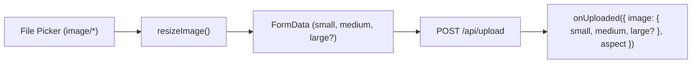

# Handoff: PR-32 / T-041
## Builder notes
### What changed
Implemented `<UploadButton onUploaded={({ image, aspect }) => ...} />` and `uploadArtwork()` in `src/upload/UploadButton.tsx` on branch `feat/T-041-upload-button` (PR #32):
- Image file picker input with `accept="image/*"`.
- Resizes file via `resizeImage` into `small`, `medium`, and optional `large` WebP blobs.
- Sends multipart form POST to `/api/upload`.
- Shows thumbnail preview of uploaded image, busy status indicator ("Uploading..."), and readable error messages for oversized files, invalid format, and server errors.
- Invokes callback with uploaded URLs (`{ small, medium, large? }`) and original `aspect` ratio.
- Accompanied by unit tests in `src/upload/UploadButton.test.tsx` verifying multipart formatting, optional size handling, and error mapping.

### Diagram


### How to test
```bash
git fetch origin && git switch feat/T-041-upload-button
npm ci
npm test
npm run typecheck
npm run lint
npm run format:check
```

Expected:
- 19/19 upload tests pass.
- TypeScript, ESLint, Prettier clean.
