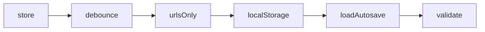

# Handoff: PR-33 / T-036
## Builder notes
### What changed
**`src/store/autosave.ts`:**
- **`startAutosave(store, key?)`:** debounced 500 ms, saves under `pegasus:gallery:<id>`, and only on document changes. It returns `stop()`, which flushes any pending save.
- **`loadAutosave(id)`:** returns a validated `Gallery` or null.
- **`saveAutosave` / `clearAutosave`:** never throw.
- **Size:** only URLs are saved (artworks with `data:` images are dropped), and documents over about 1 MB are skipped.

**For builder-2 (wiring the editor):**
```ts
// on mount:
const saved = loadAutosave(galleryId); if (saved) useGalleryStore.getState().loadGallery(saved);
const stop = startAutosave(useGalleryStore); // return stop from the effect cleanup
```
### Diagram

### How to test
```bash
git fetch origin && git switch feat/T-036-store-autosave && npm ci
npx vitest run src/store   # 51 passed (14 new)
```
## Review rounds
### Round 1
**Verdict** / **Blocking issues** / **Non-blocking suggestions** / **What I tested**
## DevOps notes
CI result / merge commit / release note
