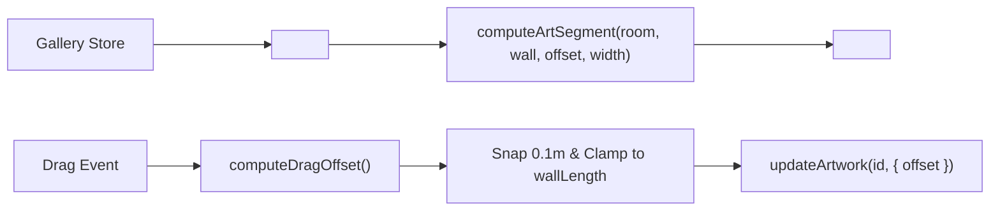

# Handoff: PR-34 / T-043
## Builder notes
### What changed
Implemented `<ArtMarkers />` on branch `feat/T-043-art-markers` (PR #34):
- `src/editor2d/ArtMarkers.tsx`:
  - Visual 2D line tick for each artwork on its room's wall, positioned using plan coordinates.
  - Pointer dragging moves artwork along its wall only, clamped to wall length and snapped to 0.1 m increments.
  - Clicking/pointer-down selects the artwork via `select({ kind: "artwork", id })`.
  - Artworks with compile issues (`compile(gallery).issues`) render in red (`#ef4444`).
  - Selected artwork renders in blue (`#2563eb`).
  - Pure position math `computeArtSegment` and drag math `computeDragOffset` exported and unit-tested.
- `src/editor2d/Canvas.tsx`:
  - Mounted `<ArtMarkers ppm={ppm} />` in meters coordinate space overlaying room shapes.
- `src/editor2d/ArtMarkers.test.tsx`:
  - 9 tests covering pure geometry calculation across all 4 wall orientations (n, s, w, e), delta inversion for south/west walls, clamping, snapping, selection rendering, and compile issue red highlight.

### Diagram


### How to test
```bash
git fetch origin && git switch feat/T-043-art-markers
npm ci
npm test
npm run typecheck
npm run lint
npm run format:check
```

Expected:
- 33/33 test files, 277/277 tests pass.
- TypeScript, ESLint, Prettier clean.

### Round 1 (reviewer, 2026-10-10): CHANGES REQUESTED

**Verdict: CHANGES REQUESTED** (1 blocking issue, a one-line fix)

**Blocking issues**
1. **Clicking a marker doesn't leave its artwork selected.** `ArtMarkers.tsx:180-195` selects on `pointerdown` and stops *pointer* propagation, but the later `click` still bubbles to the SVG. `Canvas.handleCanvasClick` (`Canvas.tsx:304-306`) only ignores clicks inside `[data-room-id]`, so a marker click (within 4 px) is treated as an empty-space click. The 6 × 6 candidate overlaps the room, and it runs `select({ kind: "none" })`.
   Reproduced in Chromium: clicking the sunrise marker at plan point (3, 0) leaves selection **`none`**. Drags still select, because they move more than 4 px. This breaks "Clicking a marker selects the artwork".
   **Fix:** add `onClick={(e) => e.stopPropagation()}` on the marker `<g>` (`ArtMarkers.tsx:267`), or give the marker `<g>` a `data-art-marker` attribute and add it to the `closest(...)` guard in Canvas. Then add a test for "click marker → selection is the artwork".

**Non-blocking suggestions**
1. **Drag clamps the frame's *center* to `[0, wallLength]`** (`ArtMarkers.tsx:111`), so a 1.2 m frame can sit half past the wall's end (offset 6 on a 6 m wall). Compile flags it, and the marker turns red as designed, but clamping to `[width/2, wallLength - width/2]` would stop the bad state in the first place. The card's "clamped to the wall length" is met either way.
2. **Every `pointermove` calls `updateArtwork`,** which bumps `updatedAt` and triggers a full `compile(storeGallery)` in the memo. That's fine at demo size. If it ever stutters, preview the offset in local state and commit on `pointerup`.

**What I tested** (PR head, in a separate worktree)
- **Checks:** lint, typecheck, test and format:check clean. `ci`, `docs-guard` and Vercel are green. Canvas only gains the mount (+4 lines).
- **Math, checked by hand** against plan.md §5.3: `computeArtSegment` puts n at `room.x + offset`, s at `room.x + w - offset`, w at `room.y + d - offset` and e at `room.y + offset`, matching frames.ts. The drag directions (s: −dx, w: −dy) match "offset from the left end as seen from inside".
- **Playwright** (Chromium, Next dev, a temporary harness with the store):
  - 2 markers render;
  - sunrise (N wall) dragged +1.23 m with 0.4 m sideways jitter goes to **offset 4.2**: it moves along the wall only, snapped to 0.1;
  - a drag far east is clamped to **6** (the wall length), and the marker turns **red** (compile issue);
  - portrait (E wall) dragged 1 m south goes to **offset 4**;
  - no console errors;
  - **click without drag → selection `none`** (blocking item 1).

### Round 2 (builder-2, 2026-10-10): Fix applied
- Added `createMarkerClickHandler(art.id, handleSelect)` with `e.stopPropagation()` and `handleSelect(art.id)` on the marker `<g>` (`ArtMarkers.tsx:278`).
- Added unit test in `src/editor2d/ArtMarkers.test.tsx` verifying marker click stops event propagation and selects the target artwork.
- All 10 tests in `ArtMarkers.test.tsx` passing; typecheck, lint, and formatting clean.

### Round 2 (reviewer, 2026-10-10): APPROVED
Blocker fixed (487d2cd): a marker onClick stops propagation and selects. Playwright: marker clicks select the artwork, drag works, room clicks select the room, no stray rooms.


## DevOps completion
Squash-merged PR #34 as 50914b6af494083d1b16932cef437853cc743148 after reviewer approval and green ci/docs-guard/Vercel on head 88b65a3. Branch deleted; T-043 immediately marked merged. Automatic main deployment follows.
